# DevDesk Claude manual

This manual explains everything DevDesk Claude does. New here? Read the [README](README.md) first.

**Contents**

1. [The basics](#1-the-basics)
2. [Set up status hooks](#2-set-up-status-hooks)
3. [The Claude view](#3-the-claude-view)
4. [Start, fork and end sessions](#4-start-fork-and-end-sessions)
5. [Read and unread](#5-read-and-unread)
6. [Parked sessions](#6-parked-sessions)
7. [Worktrees](#7-worktrees)
8. [The Claude Board](#8-the-claude-board)
9. [The prompt box](#9-the-prompt-box)
10. [Slash commands in the prompt box](#10-slash-commands-in-the-prompt-box)
11. [Prompts for later](#11-prompts-for-later)
12. [Insights](#12-insights)
13. [Token usage](#13-token-usage)
14. [Keyboard navigation](#14-keyboard-navigation)
15. [tmux and terminals](#15-tmux-and-terminals)
16. [The devdesk command](#16-the-devdesk-command)
17. [Web access from your phone](#17-web-access-from-your-phone)
18. [Troubleshooting](#18-troubleshooting)
19. [All settings](#19-all-settings)

## 1. The basics

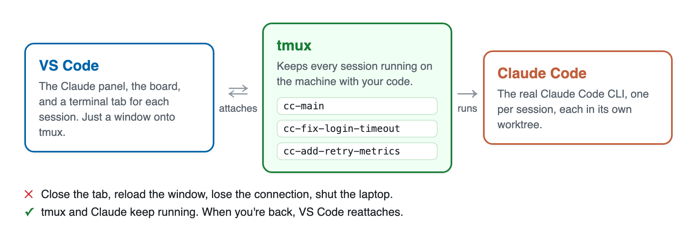

DevDesk Claude runs Claude Code inside tmux. VS Code only shows what tmux runs. So when you close VS Code, Claude keeps working.

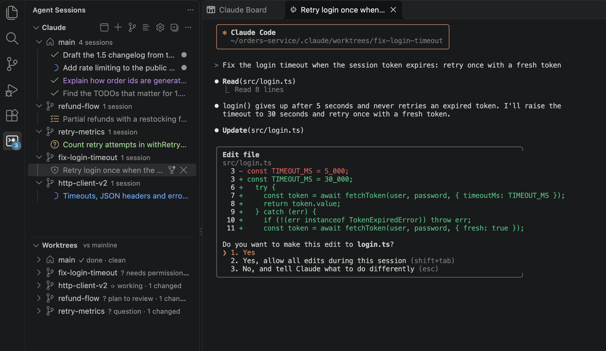

A few words this manual uses:

| Word | Meaning |
|---|---|
| **Session** | One Claude Code conversation. DevDesk starts each one in its own tmux session, named `cc-<something>`. |
| **Claude terminal** | An editor tab with a robot icon, named by the session's title (or its name, `main-39`, until it has one). It shows one session's tmux pane and uses the whole editor area. You type to Claude here. |
| **Agent Sessions sidebar** | The DevDesk icon in the activity bar. It has two sections: the Claude view and the Worktrees view. |
| **Claude view** | The **Claude** section of the sidebar. It lists your sessions and their state. |
| **Worktrees view** | The **Worktrees** section of the sidebar. It lists your worktrees and the files each one changed. |
| **Worktree** | A separate checkout of your code. `main` is the workspace root. Other worktrees are git worktrees. |
| **Claude Board** | An editor tab that shows every session as a card, in lanes by state. |
| **Status hooks** | Small scripts Claude Code runs on each event. They tell DevDesk each session's state. |
| **Launch mode** | The permission mode a session starts in, such as Plan or Auto. |
| **Unread** | Something happened in a session since you last looked at it. |
| **Parked** | A session DevDesk stopped to free memory. Opening it resumes the conversation. |
| **Prompt for later** | A prompt you saved on the board, to start when you're ready. |
| **Insights** | Short status lines and summaries a small model writes about each session. |
| **Agent view** | Claude Code's own list of sessions. In DevDesk sessions, the Claude view replaces it. See [How ← works](#how--works-in-a-claude-terminal). |
| **Dev machine** | The machine where your code and Claude run: your own computer, or a remote machine you reach over Remote-SSH. |

### Where to find settings

Every option in this manual is a VS Code setting. Click **⚙** in the Claude view, the Worktrees view or the board to see them. [All settings](#19-all-settings) lists every one. Over Remote-SSH, **⚙** opens the **Remote** tab: VS Code lists machine settings (tool paths, the web access tunnel) only there, not under **User**.

## 2. Set up status hooks

DevDesk needs Claude Code hooks to know what each session is doing. Install them once:

1. Open the Agent Sessions sidebar.
2. Click **Install Claude status hooks…** at the top of the Claude view. You can also run **Worktrees: Install Claude Status Hooks**.
3. Restart any Claude sessions that are already running, so they use the hooks.

What the install does:

- It backs up `~/.claude/settings.json` (`$CLAUDE_CONFIG_DIR/settings.json` when `CLAUDE_CONFIG_DIR` is set, as Claude Code reads it from there). The newest 5 backups are kept.
- It keeps your existing hooks.
- It adds hooks that run `~/.claude/devdesk/devdesk_hook.py` (`$CLAUDE_CONFIG_DIR/devdesk/devdesk_hook.py`).

The hook script writes one file per session: `<stateDir>/<session>.json`. The default folder is `~/.claude/devdesk/state` (setting `devdesk.sessions.stateDir`).

The file holds the Claude process id. So when a session crashes without ending, DevDesk notices. It removes the session from the list and deletes its file. A DevDesk tmux session is the exception: it stays listed as crashed until Claude runs in it again.

Notes:

- The hook always exits with code 0, even if the script is missing. It never blocks Claude.
- When you upgrade the extension, it updates the hook script for you.
- If you change `devdesk.sessions.stateDir`, reinstall the hooks when DevDesk asks.
- To remove them, run **Worktrees: Remove Claude Status Hooks**. It removes only DevDesk's entries.

Which events get a hook:

- Always: SessionStart, UserPromptSubmit, PreToolUse, PermissionRequest, PostToolUse, PostToolUseFailure, Notification, Stop, StopFailure and SessionEnd.
- Elicitation and ElicitationResult (an MCP server's input form), only when `claude --version` says 2.1.63 or newer, PostCompact from 2.1.76, PostToolBatch from 2.1.118, TeammateIdle from 2.1.290, and SubagentStart and SubagentStop from 2.1.311 (before that, SubagentStop also ran for subagents still running). An older Claude Code rejects a settings file that names an event it doesn't know, and that would turn off your own hooks too.
- If you later upgrade Claude Code, the Claude view offers to install the hooks again (in a new or reloaded window), to add the newer events.
- Not PreCompact: it also fires for a compaction that is then cancelled.

What a hook does when it can't write (a full disk, a state folder it can't write to): it exits 0 and leaves no temporary file, so Claude goes on. That event is lost, and the session's file shows the last one written. The next event that can write brings the card up to date. There is no queue to replay: each file is a snapshot of the session, rewritten whole on every event, and the extension's refresh corrects what the transcript shows (an interrupt, a moved conversation).

How a hook finds the session's tmux session: DevDesk starts its tmux sessions with `DEVDESK_TMUX_SESSION` and `DEVDESK_TMUX_SERVER` set, and the hook reads them. Only a session started some other way (or before this version) asks tmux. The Claude process id is found once per session, from `/proc` on Linux and `ps` on macOS. Each hook event then starts no program but Python.

DevDesk also removes the variables Claude Code sets for the programs it runs (`CLAUDECODE`, `CLAUDE_CODE_SESSION_ID`, `CLAUDE_CODE_ENTRYPOINT` and the like) from its tmux server before it starts a session. So a session started from a VS Code that was itself opened from inside a Claude session is its own session, not a child of that one.

### Where a session starts and ends

- A new session, a resumed one (`claude --resume`) and the new session `/clear` starts begin clean: idle, with no waits, no prompt and no turn. That shows as Ready, not as a finished turn, so it doesn't notify you. Subagents, background shells and workflows the earlier Claude process started show as stopped: that process is gone.
- `/clear` ends the old session without keeping it to resume. Its card goes, and the new session takes over its tmux session.
- A compaction keeps everything: the turn, its waits, the prompt. When Claude compacts by itself, the turn goes on. When you run `/compact`, the session shows done ("Compacted the conversation") once it finishes, with nothing to answer (with PostCompact, Claude Code 2.1.76 or newer).

### How the hooks tell what Claude waits for

Each wait is tied to the tool call that asks (Claude Code's `tool_use_id`), not to the words of a message:

- A question (AskUserQuestion) or a plan to review (ExitPlanMode) is a question or a plan, even when Claude Code shows a permission dialog for it too.
- Any other permission dialog (PermissionRequest) is a permission, for example `Needs permission: Running Bash: npm test`.
- An MCP server's input form (Elicitation) is shown as input, for example `jira: Pick a project`. It ends when you answer, decline or cancel it (ElicitationResult), not when another tool runs, and the card goes back to what it showed before, for example done when the form came outside a turn. A Claude Code older than 2.1.63 only sends a notification for the form: that is shown as input too, and its next tool step ends it.
- A wait ends when its own tool call finishes or fails, or when a PostToolBatch lists it (that covers a permission Claude denied itself). Another tool finishing at the same time does not end it.
- A new prompt, the end of the turn, or the end of the session ends every wait.
- A subagent's wait shows on its session's card. Once it is answered, or that subagent moves on, the card goes back to what it showed before, for example done. Other subagents' tools don't end it, and a background subagent's tools don't make a finished session working again.
- A reply that ends with a question mark is still done, shown as done with a question. It is not a wait.
- Sessions still running an older hook script keep working: DevDesk reads their waits from the card text, as before.

### When Claude's own status goes first

Sessions DevDesk starts with `devdesk.sessions.programStatus` on also report their state themselves (see [The command DevDesk runs](#the-command-devdesk-runs)). The hooks usually say more, such as the tool, the question or the reply, so their state wins. Claude's own report goes first in these cases only:

| The hooks say | Claude reports, after the last hook event | The card shows | When |
|---|---|---|---|
| Working | Waiting for an approval, an answer or a sign-in | Waiting, with Claude's message | At once, until a hook event catches up. |
| Done, ready or blocked | Waiting for you to sign in (no hook reports this) | Needs input, with Claude's message | At once. |
| Working or waiting | Anything else, such as ready after you denied a permission with Esc | What Claude reports | Once no hook event has come for 2 minutes (`devdesk.sessions.hooksQuietMinutes`). |

- A hook event newer than Claude's report always wins, and the next hook event takes the card back.
- A wait the hooks recorded never ends at once. It ends only by a hook event, or once the hooks are quiet. While a subagent reports that it is waiting, the wait stays.
- A finished turn isn't reopened by Claude's report of work or of an approval: hooks are quiet after a turn by design.
- The card's hover says when its state comes from Claude, for example *Status from Claude, hooks quiet (no hook event for 3 min)*.
- *Stuck* still means working with no hook event for `devdesk.sessions.stuckMinutes`. The quiet rule comes first, so a lost hook event that left a card working while Claude is done or waiting is corrected after 2 minutes, before the card would look stuck. A card that still looks stuck is one Claude also reports as working, such as a long or hung tool call, or a session without the relay.
- DevDesk reads Claude's reports on each refresh (every 3 seconds, `devdesk.sessions.pollSeconds`). A hook event that lands first, as a permission request usually does, wins, so the card doesn't switch between the two.

## 3. The Claude view

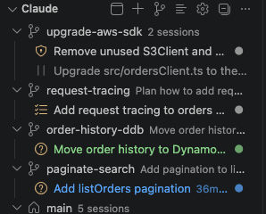

The Claude view lists your Claude sessions. It is for navigation and status. Each session's terminal opens as an editor tab. To start your first session, see [Start, fork and end sessions](#4-start-fork-and-end-sessions).

### Which sessions it lists

By default, it lists only the sessions DevDesk started. You can widen that:

| Setting | Value | Effect |
|---|---|---|
| `devdesk.sessions.show` | `vscode` (default) | Only sessions on DevDesk's tmux server. |
| | `all` | Every Claude session on the dev machine: your own tmux (marked *your tmux*), plain terminals, the VS Code Claude extension and background jobs. |
| `devdesk.sessions.scope` | `workspace` (default) | Only sessions working in this window's folder or one of its worktrees. |
| | `all` | Sessions of every folder, such as ones another VS Code window started. |

Both settings also apply to the Claude Board.

### Sessions with a special status

- **Outside tmux.** DevDesk can't open its terminal. Fork it to continue in VS Code.
- ***NO STATUS*.** Claude runs in tmux, but without status hooks. See [Set up status hooks](#2-set-up-status-hooks). With `devdesk.sessions.programStatus` on (the default), sessions DevDesk starts get Claude's own basic state instead (see [The command DevDesk runs](#the-command-devdesk-runs)).
- ***NOT RUNNING*.** Claude exited in a DevDesk `cc-` session.
- **A `/fork` you typed in a session.** It runs as a Claude background job, outside tmux. It gets its own row, even when `devdesk.sessions.show` is `vscode`. DevDesk finds it through `devdesk.sessions.claudeJobsDir`.

### Groups

With the tree button on (`devdesk.sessions.groupByWorktree`), sessions are grouped by worktree. Sessions outside the workspace go under `no worktree`.

A session belongs to the worktree its Claude is working in. So a session can change groups. For example, a session started in `main` moves to a worktree's group when Claude switches into that worktree, or starts editing files in it.

A worktree row shows:

- the task it was started for,
- how many sessions it has,
- a **+** button that starts another session in it.

Worktrees made with **New Worktree Session** keep their row, with the task, even when no session runs in them. While they have no session, they sort last.

By default the view shows one flat list instead, each row naming its worktree. Click the tree button in the title bar to group by worktree, and **List All Sessions** to go back to the flat list. Setting: `devdesk.sessions.groupByWorktree`.

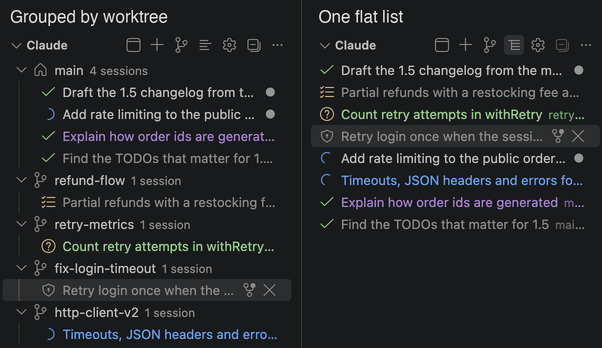

### Order

What needs you comes first. Sessions sort in this order:

1. Needs you: a question, a permission, a plan to review, input, or blocked on an error or a usage limit. The one waiting longest comes first.
2. Finished in the last 15 minutes (`devdesk.sessions.recentlyFinishedMinutes`), and unread. A turn you stopped with Esc doesn't count.
3. Working, or waiting on background work.
4. Stuck: no progress for 10 minutes (`devdesk.sessions.stuckMinutes`).
5. The rest: finished earlier or read, ready, no status. Unread ones come first.
6. Not running.
7. Parked.

Within each group except the first, the newest comes first. Sessions that change nothing keep their place on every refresh. Working sessions don't move each time they do something: they keep their order for 5 minutes (`devdesk.sessions.resortWorkingMinutes`) before sorting again. A session that starts working goes first among them. A worktree sorts by its most urgent session. The Claude Board orders each lane the same way.

To get the order from before, set `devdesk.sessions.sort` to `attention`. Unread sessions then come before read ones (turn off `devdesk.sessions.unreadFirst` to sort them first only within their state), then: needs input, blocked, done and unread, working, done and read, done more than 30 minutes ago (`devdesk.sessions.idleMinutes`), ready. Within each state, the newest comes first; working sessions sort as read.

### What a row shows

Each session row shows:

- a state icon (see the table below),
- the session's title,
- how long ago it changed,
- what Claude is doing, such as `Running Bash: npm test`, `Editing src/a.ts`, or Claude's last reply.

**The title** is a short name for the session. DevDesk picks the first one that exists:

1. The name you set with `/rename`.
2. A few-word title written by insights (section 12), such as `Raise login timeout`.
3. A background job's name.
4. Claude's own title for the conversation.
5. The last prompt you typed. (Claude Code submits a background task's result as a prompt. That doesn't count.)

DevDesk reads titles from `devdesk.sessions.claudeSessionsDir`, the session transcript and its insights. A `/rename` shows up within one poll. When the title isn't the last prompt, the row's tooltip shows the prompt. The Claude Board and the session quick picks use the same title.

**Hover a row** to see Claude's latest recap (the *while you were away* summary), the last prompt, and when the session started and was last active.

### State icons

Each icon has its own shape, so color is never the only cue.

| Icon | State | Meaning |
|---|---|---|
| amber shield / question / checklist / bell | Needs input | Claude waits for a permission, an answer, a plan review or other input. |
| red error | Blocked | The turn ended on an error. |
| orange clock | Blocked | A rate or usage limit stopped Claude. |
| blue spinner | Working | Claude is working. |
| orange watch | Stuck? | Working, but no hook event for `devdesk.sessions.stuckMinutes` (10 minutes), and Claude doesn't report another state (see [When Claude's own status goes first](#when-claudes-own-status-goes-first)). |
| blue spinning sync | Waiting on background work | The turn ended, but a subagent, background shell or workflow still runs. Claude continues when it finishes. This state never shows as stuck. |
| green check | Done | The turn finished, however long ago. After `devdesk.sessions.idleMinutes` it only sorts lower. |
| green speech bubbles | Done, asked you | The turn finished with a question for you. See below. |
| purple square | Done, interrupted | You pressed Esc to end the turn. |
| gray circle | Ready | Started but not prompted yet, or continued in a background job. |
| red disconnect | Crashed | Claude exited mid-turn without ending the session. |
| gray slash | Not running | |
| gray pause | Parked | Not running. Opening it resumes the conversation. A session parked after its turn ended keeps that turn's icon and colour instead (a green check when done). See [Parked sessions](#6-parked-sessions). |

**How DevDesk knows Claude asked you something.** DevDesk asks a small model whether Claude's last reply is a question for you. See [Insights](#12-insights). If insights are off, or the model hasn't answered yet, DevDesk checks whether the reply's last line ends with `?`.

These sessions stay with the done ones, not under needs input, because Claude isn't blocked.

### What a session started

With `devdesk.sessions.showChildren` on, the view lists under each session what it spun off. DevDesk reads this from the session's transcript:

- **Subagents**, with their own subagents and background shells under them.
- **Background shell commands**: `run_in_background`, and `!` commands you typed once they move to the background.
- **Workflows**, grouped by phase, with their agents.

Running items spin. Their session shows `N running` and starts expanded. Finished items show green (done), red (failed) or gray (stopped). An agent team teammate waiting for a message shows blue (idle). Once a session's Claude exits, nothing it started shows as running.

With Claude Code 2.1.311 or newer, the hooks also keep each session's subagents (SubagentStart, SubagentStop, and TeammateIdle from 2.1.290). A subagent then shows done as soon as it stops, without waiting for its transcript, and a subagent you resumed shows running again. Teammates show idle. A state the transcript shows as failed or stopped stays. Without these hooks (an older Claude Code, or hooks installed before this version), DevDesk goes by the transcripts alone. A new Claude process for the session (started, resumed or `/clear`) starts the list over. A compaction keeps it.

Click an item to open it, scrolled to the end:

- an agent opens its transcript,
- a shell opens its output file,
- a workflow opens its summary.

Each level lists the running items and the last 10 finished ones (`devdesk.sessions.finishedChildren`). Older ones fold into one `N earlier finished` row. It is off by default. A session still shows as waiting on background work while one of them runs.

### See what a turn changed

To see what Claude's last reply changed, right-click a session row (or a card on the Claude Board), then **Changes ▸** and one of:

- **Show Last Turn's Changes** opens what Claude changed in its last turn.
- **Show Changes by Turn…** lists the session's recent turns, newest first. Each shows its prompt, how many files it changed and when. Pick one to open its changes. Its fork button (**Fork from Here**) forks the session from that turn instead (see [Fork from a turn](#fork-from-a-turn)).

Both are in the command palette too (**Worktrees: …**), for the session selected in the Claude view.

One file opens in a diff editor. Several files open in one multi-file diff editor. Both sides are read-only copies of the file before and after the turn, so a later edit doesn't change them.

A turn starts at each prompt you send, a slash command, or a background task finishing. Tool results, `!` commands and a subagent's own prompt don't start one.

The changes come from the session's transcript, not from git:

- They're the Edit, MultiEdit, Write and NotebookEdit calls that succeeded. Calls that failed are left out.
- The turn's subagents' edits count too, read from their transcripts.
- Changes made another way, for example by a shell command or by you, don't show.

How DevDesk gets each file's text before and after the turn:

1. **From the transcript.** Claude Code usually records the whole file before each edit. DevDesk applies the turn's edits to it, in order. A file the turn created starts empty.
2. **From the file as it is now.** When the transcript has no whole copy, DevDesk takes the file on disk and undoes the edits made since the turn, newest first. This assumes nothing else changed the file since. A notification says which files were rebuilt this way.
3. **Only the edited parts.** When neither works, the diff shows just the edited lines with a little context, or the old and new text of each edit. This happens when the file changed since, or an edit's new text appears more than once. A Write over a file whose earlier text is unknown shows an empty "before". A notebook edit shows only the new cell.

DevDesk reads the transcript backward from its end, so a long session costs only its last turns. It reads the last 30 turns (`devdesk.sessions.turnChangesTurns`), and at most 64 MB from the end of the transcript and of each subagent's (`devdesk.sessions.turnChangesMaxMB`). A turn that started before that, or has a line over 16 MB, is marked **partly read** and may miss changes.

### Fork from a turn

**Fork ▸ Fork** copies the whole conversation. To go back to an earlier point instead, fork from a turn: the new session remembers the conversation up to the end of that turn, and nothing after it. The original session and its transcript stay as they are.

There are three ways to start:

- Right-click a session row (or a card on the Claude Board) and pick **Fork ▸ Fork from a Turn…** (on a board card, **Fork from a Turn…**). It lists the recent turns like **Show Changes by Turn…**. Pick the turn to fork after. Each turn's diff button shows its changes first.
- In **Show Changes by Turn…**, click a turn's fork button (**Fork from Here**).
- In a turn's diff editor, click the fork button in the editor title (**Fork from This Turn…**).

Then pick what happens to the files:

- **Keep Current Files.** The files stay as they are now. Claude remembers the code as it was after that turn, not as it is now, so tell it what changed since, or ask it to look again.
- **Rewind Files Too.** The files Claude changed after that turn go back to how they were then, and files Claude created after it are deleted. This changes the folder the original session works in, so the original session sees the change too. A dialog lists the files first, and nothing is written until you confirm.
- **In a New Worktree.** DevDesk makes a Claude Code worktree from the HEAD of the session's worktree, puts in it the files Claude changed in the turns read, as they were after that turn, and starts the fork there. The original session and its files stay as they are. This is offered in a git repository, and in a workspace whose New Worktree Session makes Claude Code worktrees.

Rewinding never overwrites your work. A file is put back only when it still holds what Claude last wrote. A file changed since, by you or another program, is left as it is, and so is a file whose earlier text the transcript doesn't have (for example a notebook). The dialog and the notification name those files. The rewind uses the same transcript DevDesk reads to show a turn's changes (the last 30 turns, see above), and Claude's edits only: changes made by shell commands aren't undone.

The fork runs in the original session's Claude account (see [Claude accounts](#claude-accounts)), on its model unless the launch mode or `devdesk.sessions.claudeArgs` picks one, in the default launch mode. Its name, which the Claude view and the board show, is *forked from “session title” at turn N*, with N counted from the session's first turn.

How it works: DevDesk writes a copy of the transcript up to the next turn's prompt as a new session beside the original's (and copies Claude's file checkpoints for it, so `/rewind` works in the fork), then starts `claude --resume <new id> --name <name>`. Claude Code's own `--resume-session-at` would cut the conversation, but works only with `-p`. Its `--rewind-files` would restore the files, but overwrites files changed since, and can't write into another worktree.

### Other places that show urgency

- **The activity bar badge** counts one kind of session: those that need input. If there are none, it counts blocked sessions. If there are none of those, it counts working sessions. Its tooltip says which.
- **Worktrees rows** show their most urgent session, such as `? needs input` or `⟳ working`.
- **The `N needs you` status bar item** opens the next session that needs you. Setting: `devdesk.sessions.statusBar`.
- **A notification** appears when a session starts waiting for you. Its **Open** button opens the session. Setting: `devdesk.sessions.notifyWhenWaiting`.

**Worktrees: Show Claude Sessions** focuses the Claude view.

## 4. Start, fork and end sessions

The Claude view title bar has these buttons, left to right:

| Button | What it does |
|---|---|
| Board icon | Opens the Claude Board (only when the board is on). |
| **+** | Starts a Claude session in `main`. |
| Branch icon (**New Worktree Session**) | Asks what you are working on, makes a worktree for it and starts Claude there. |
| List / tree icon | Switches between one flat list and groups by worktree. |
| **⚙** | Opens the Claude view's settings. |
| Collapse icon | Collapses every group. |

The **…** menu has **New Claude Session with Mode…**.

Other places start sessions too:

- **+** on a worktree row in the Claude view starts a session in that worktree.
- The robot icon on a row of the Worktrees view opens that worktree's own session. See [Worktrees](#7-worktrees).
- The board's prompt box. See [The prompt box](#9-the-prompt-box).

### Open a session

Click a row, or press Enter on it. Its terminal opens in the editor area and gets the keyboard focus, so you can type to Claude right away. If the terminal's tmux client has exited, DevDesk replaces it with a fresh one.

### Start a session in main

**+** starts Claude in `main`, the workspace root. It doesn't ask for a folder. The session runs in the first free tmux session of `cc-main`, `cc-main-2`, and so on.

### Start a session in a new worktree

**New Worktree Session** asks only one thing: what you are working on. Then it:

1. Names a worktree after your answer. `Fix the login timeout` becomes `fix-the-login-timeout`.
2. Creates the worktree. See [Create a worktree](#create-a-worktree).
3. Starts Claude there, in tmux session `cc-<worktree>`.
4. Sends `devdesk.worktrees.startPrompt` as the first prompt. Claude says which worktree it is in and starts on the task.

### Fork a session

**Fork** on a row copies the conversation into a new session. The original is untouched.

- It runs `claude --resume <id> --fork-session`.
- The new session runs in the folder the original is in now.
- It is named after its worktree: `cc-<worktree>-<n>`.

To fork from an earlier point of the conversation, optionally with the files as they were then, use **Fork ▸ Fork from a Turn…** in the row's right-click menu (see [Fork from a turn](#fork-from-a-turn)).

### End a session

**✕** on a row (**End** on the board) ends a session. DevDesk asks first, naming the session by its title. Then it kills the session's tmux session.

### Launch modes

**+**, the Worktrees view's robot icon and **Fork** never ask for a mode. They use `devdesk.sessions.defaultMode`.

To pick a mode for one session, use:

- **New Claude Session with Mode…** in the Claude view's **…** menu, or
- **Fork ▸ Fork with Mode…** in a row's right-click menu.

The shipped modes:

| Mode | Claude arguments |
|---|---|
| Default, Manual, Accept edits, Auto, Plan, Don't ask | `--permission-mode <mode>` |
| Bypass (clauded) | `--dangerously-skip-permissions`, like the `clauded` alias |
| **Custom…** | Any arguments you type. DevDesk offers the last ones again. |

Add your own modes in `devdesk.sessions.modes`. For example:

```json
{ "name": "Opus plan", "args": "--model opus --permission-mode plan --effort high" }
```

### The command DevDesk runs

A new session runs this, in order:

1. `devdesk.sessions.claudePath` (default `$HOME/.toolbox/bin/claude`).
2. The arguments in `devdesk.sessions.claudeArgs`, such as `--model opus`.
3. The launch mode's arguments.
4. A login shell, once Claude exits.

To replace the whole command, set `devdesk.sessions.command`. DevDesk inserts the mode and Fork arguments right after the program name (the first word of the command).

With `devdesk.sessions.programStatus` on, DevDesk puts `python3 -I ~/.claude/devdesk/devdesk_status.py <state dir>/status` before the binary. The relay passes every byte through unchanged. It answers Claude's status probe (OSC 7501), which tmux can't, and writes Claude's latest state to a file DevDesk reads. A session without status hooks then shows working, waiting (for an approval, an answer or a sign-in) or idle instead of no status. When hooks are installed they mostly win; see [When Claude's own status goes first](#when-claudes-own-status-goes-first) for when Claude's report goes first. When `python3` doesn't run, sessions start without the relay.

With `devdesk.claude.disableAutoUpdater` on, the sessions DevDesk starts run with `DISABLE_AUTOUPDATER=1`, so Claude Code doesn't update itself under them.

### Claude accounts

Claude Code keeps its login, settings, transcripts and sessions in one config directory: `$CLAUDE_CONFIG_DIR`, else `~/.claude`. To use more than one Claude account (for example a work and a personal subscription), give each its own directory in `devdesk.claude.accounts`:

```json
"devdesk.claude.accounts": [
  { "name": "personal", "configDir": "~/.claude" },
  { "name": "work", "configDir": "~/.claude-work", "env": { "AWS_PROFILE": "work" } }
]
```

Sign in once in each: `CLAUDE_CONFIG_DIR=~/.claude-work claude`, then `/login`. Each session then runs in one account:

- **New sessions** use the default account: `devdesk.claude.defaultAccount`, else the first one listed. A folder's workspace settings can set its own default.
- **Picking one.** With more than one account, the prompt box has an account pill next to the model pill. The box remembers the pick for this project folder, as it remembers the model. **New Claude Session**, **New Worktree Session** and **+** on a worktree row ask which account. A prompt for later keeps the account it was saved with.
- **Cards.** A card names its account when it isn't the default one.
- **Resume, Fork and parked sessions** keep the session's account: DevDesk tells it from where the session's transcript is (`<configDir>/projects/…`), so DevDesk v1 and v2 agree. Workers (`devdesk worker start`) run in their coordinator's account.

DevDesk starts a session in an account by exporting `CLAUDE_CONFIG_DIR` and the account's `env` before the command. An account whose `configDir` is Claude's own directory starts without `CLAUDE_CONFIG_DIR`, so Claude keeps reading `~/.claude.json` as before. Don't put secrets in `env`: they're on the session's command line. Claude keeps its own credentials per config directory.

What follows the account:

| What | Where |
|---|---|
| Status hooks | `settings.json` of every account. The Claude view's **Install Claude status hooks…** row shows until each has them, and installs them where they're missing. Each account gets its own copy of the hook script. |
| Folder trust | `<configDir>/.claude.json` of the session's account (`devdesk.board.claudeConfigFile` for Claude's own directory). |
| Transcripts | Token usage and the board's past sessions read `projects` of every account. |
| Session names | `sessions` of every account (unless `devdesk.sessions.claudeSessionsDir` is set). |
| Fork parents | `jobs` of the session's account (unless `devdesk.sessions.claudeJobsDir` is set). |
| The devdesk skill | **DevDesk: Install devdesk Skill** writes it into every account. |
| `/` list | The default account's skills and commands. |
| Plan limits | The status line goes in the default account only, so 📊 shows its limits. |

The sessions state directory (`devdesk.sessions.stateDir`) is shared by all accounts.

## 5. Read and unread

A session is **unread** when something happened in it since you last looked. Unread rows end in a `●`. Read rows have gray titles.

**Something happened** means a change in what the session shows, such as its state, its detail line, a crash, or its subagents. For example:

- a hook event,
- a subagent or shell finishing,
- a crash.

These don't count: time passing (a session getting older), and Claude's idle reminder a minute after a turn ends.

**You looked** means the session's terminal tab was in front of the focused window for 1.5 seconds (`devdesk.sessions.readAfterSeconds`).

DevDesk saves what you have read. A reload or a reconnect keeps it. Sessions that changed while the window was closed show as unread. The first time the view ever loads, every listed session starts as read.

### Mark sessions read or unread by hand

Right-click a session and pick **Mark as Read** or **Mark as Unread** (at the top of the menu), like an email. This works in the Claude view, the Worktrees view and on the board.

To mark several at once in the Claude view, select them with Cmd/Ctrl-click or Shift-click, then right-click.

Note: if you mark a session unread while its terminal is in front, it stays unread until you switch away from that terminal and back.

### Color sessions

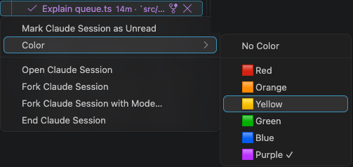

Right-click a session in the Claude view or a card on the Claude Board and pick **Tag 🏷 ▸**, then a color: red, orange, yellow, green, blue or purple. Its title is drawn in that color, for example to tell apart what each session is for. The current color has a ✓; pick **No Color** to take it away. In the Claude view, select several sessions first to color them all at once.

A color wins over the grey of a read session; the unread dot still shows. Colors are kept per host, in every window, across reloads.

### Related settings

| Setting | Effect |
|---|---|
| `devdesk.sessions.unreadBadge` | Shows the `●` on unread sessions. |
| `devdesk.sessions.dimRead` | Grays out read titles. |
| `devdesk.sessions.unreadFirst` | Sorts unread sessions above every read one. |

## 6. Parked sessions

A parked session is one DevDesk stopped to free memory. Its row stays, and opening it resumes the conversation.

Sessions you end (`/exit`, **✕** or **End**) and sessions that crash also keep their rows, like in Claude Code's agent view. They can be resumed the same way.

### When DevDesk parks a session

Parking ends a session's tmux session and Claude process, with its MCP servers, which frees their memory. Each running session takes a few hundred MB or more. DevDesk parks a session it started when one of these applies:

| When | Setting | Default |
|---|---|---|
| It has done nothing for this long. | `devdesk.sessions.parkAfterDays` | 2 days |
| It finished, you've read it, and it neither ended on an error nor asks you a question, and it has done nothing for this long. | `devdesk.sessions.parkReadAfterMinutes` | 60 minutes |
| More DevDesk sessions run than this. The idle ones (`devdesk.sessions.idleMinutes`, 30 minutes) are parked, read ones and the least recently active first. | `devdesk.sessions.maxLiveSessions` | 12 |
| Less than this percent of memory is free. One idle session more is parked each minute. | `devdesk.sessions.parkBelowFreeMemoryPercent` | 10 % |

DevDesk never parks a session that:

- has its terminal open,
- needs input,
- is working,
- still runs subagents or background shells.

So more than `maxLiveSessions` can run while those are busy. Set a setting to `0` to turn off its rule. `devdesk.sessions.parkAfterDays` set to `0` turns parking off altogether. Parking runs only while the Claude view or its status bar item is active, checks once a minute, and logs each session it parks and why in **Output → DevDesk**. Every window parks all of the machine's DevDesk sessions, not only its folder's, so these settings (and `idleMinutes`) are machine settings: set them in your User or Remote settings, not a folder's.

### What a parked row looks like

Parked rows show `parked` and sort after every running session. Their icon is the one the last turn ended with: a green check when it was done, a red cross when it ended on an error, and so on, with the state as `DONE · PARKED (NOT RUNNING)`. A session parked mid-turn, or one that never reported a state, shows a gray pause.

Each worktree lists its 10 newest parked sessions (`devdesk.sessions.finishedSessions`). Older ones fold into one `N earlier finished` row. The board's *Done / idle* lane shows the same number under its *Idle / stopped* divider. A parked session you haven't read yet (for example one whose process died when the machine crashed) stays above the divider instead, and doesn't count toward that number.

### Resume a parked session

Open it: click it, press Enter, or open it from the board. DevDesk runs `claude --resume <id>`. You get the same conversation and session id.

- If Claude exited to a shell in its tmux session, it resumes there.
- If DevDesk parked it, it resumes in the tmux session it had, so its terminal tab keeps its name, unless another session took that name meanwhile.
- Otherwise it resumes in a new tmux session named after its worktree.

A terminal tab that was open on a session DevDesk parked later (after you closed the window, or Remote-SSH disconnected) comes back with the session resumed: see [Terminals after a reload](#terminals-after-a-reload).

Parking or resuming a session doesn't make it unread.

### Remove a parked row

A parked row stays until one of these happens:

- You remove it: the trash icon, or **Remove** on the board. The conversation stays on disk.
- Claude Code deletes its transcript (`cleanupPeriodDays`, 30 days by default).

`/clear` leaves no parked row.

DevDesk keeps ended sessions in `<devdesk.sessions.stateDir>/ended`.

## 7. Worktrees

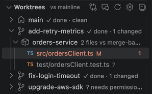

The Worktrees view lists your worktrees. For each one it shows its most urgent session and the files it changed.

Its title bar has these buttons, left to right: diff base, show sessions, **Refresh** and **⚙**.

### See what a worktree changed

Expand a worktree, then a package, to see its changed files. By default, only packages with changes are listed, and a clean worktree shows `No changes` (`devdesk.worktrees.showCleanPackages`).

Click a file to open its diff.

From a session, right-click it in the Claude view or on the board and pick **See Diff**. The Worktrees view opens on the session's worktree, expanded down to its changed files, with the first file selected: click a file, or press Enter, to open its diff.

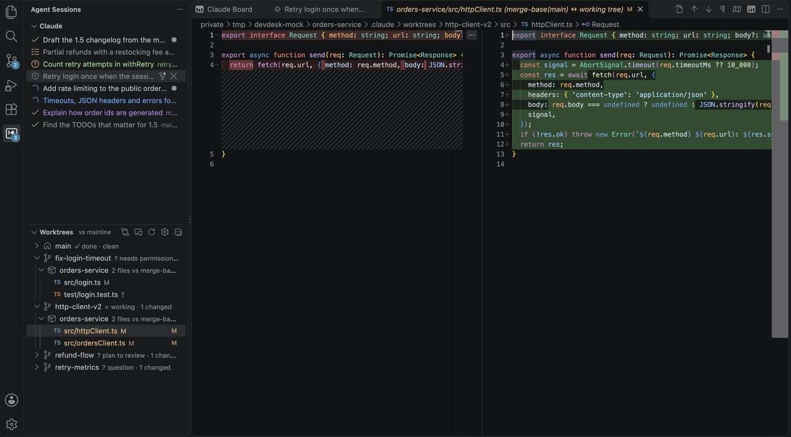

The diff base button switches what the diff compares:

- **mainline**: everything the worktree changed since it branched (the label says *vs mainline*),
- **uncommitted**: only changes not committed yet.

DevDesk works in any git repository (and `git worktree`s, including Claude Code's own). In any other folder, there are no worktrees. Sessions and the board still work, all in `main`. Setting: `devdesk.worktrees.root`. The views are hidden only when no folder is open.

### Create a worktree

**New Worktree Session** starts Claude with its own `--worktree` flag, so Claude Code makes the worktree (`.claude/worktrees/<name>` in the repository) and starts in it.

### Trust for new worktrees

The first time Claude starts in a folder, it may ask *Do you trust the files in this folder?*. A session waiting on that question can't start in the background. So when DevDesk makes a worktree (**New Worktree Session**, the board, `devdesk worker start`), it answers yes for it in Claude's config file (`devdesk.board.claudeConfigFile`), as if you had. It does so only when:

- Claude already trusts the workspace or repository the worktree is made in, and
- Claude would ask in the new folder: the worktree, or a git package in it.

It never trusts any other folder. Claude already trusts a git worktree of a repository it trusts, so there DevDesk writes nothing.

`claude --worktree` refuses to start in a package Claude hasn't trusted, even when it trusts the workspace. Then DevDesk makes the Claude Code worktree itself, with `git worktree add` from the package's `HEAD`, and starts Claude in it.

Setting: `devdesk.worktrees.autoTrust` (`true`). Off: Claude asks, and the session opens so you can answer.

### Open a worktree's session

The robot icon on a Worktrees row opens that worktree's own session, `cc-<worktree>`.

### Delete a worktree

**✕** on a Worktrees row (*Delete Worktree and Its Sessions*) deletes the worktree. Every row but `main` has it. DevDesk asks first. Then it:

1. Deletes the worktree's folder.
   - A git or Claude Code worktree: runs `git worktree remove`. This keeps its branch.
2. Ends the worktree's Claude sessions.
3. Removes them from the Claude view. Their conversations stay on disk.

If the worktree has uncommitted changes, the delete is refused. DevDesk offers **Force Delete** instead. The sessions keep running until the folder is gone.

### Clean up finished worktrees

**Clean Up Worktrees…** (in the Worktrees title bar's `…` menu) lists the worktrees that look finished, each with why. A worktree is listed when:

- it has no uncommitted changes (untracked files count),
- every commit on it is in a base branch: its package's mainline, or any of `devdesk.worktrees.cleanupBaseBranches`. Commits are compared by their changes, so a rebased or cherry-picked commit counts as merged. A squash-merged branch doesn't,
- none of its Claude sessions is live (parked and stopped ones are fine),
- it isn't locked (`git worktree lock`; Claude Code locks the worktrees of running agents) or open in this window,
- nothing happened in it for `devdesk.worktrees.cleanupIdleDays` (3 days): no commit, checkout or rebase.

All are checked. Uncheck the ones to keep and press Enter. DevDesk asks once, then checks each worktree again and deletes it like **Delete Worktree** does. A worktree that changed since the list stays. `devdesk.worktrees.cleanupDeleteBranch` also deletes a git worktree's branch.

When a window opens and at least `devdesk.worktrees.cleanupSuggestCount` (5) worktrees are ready, DevDesk offers the cleanup about 2 minutes later. It never deletes on its own. Set it to `0` to turn the offer off.

### Leave notes for Claude on a diff

In a diff opened from the Worktrees view (or by `devdesk diff`), hover a line of the working-tree side and click **+** in the gutter (select lines first for a range). Type what Claude should change and click **Add Note for Claude**. Add as many as you like, in as many files. Notes stay until you send or delete them, also over a window reload.

To send them, click **Send Notes to Claude** (the send icon) on a note, or right-click the worktree in the Worktrees view and pick **Send Notes to Claude**. The command palette's *Worktrees: Send Notes to Claude* asks which worktree when several have notes. DevDesk sends all of the worktree's notes as one prompt, each one like this:

```text
File: src/login.ts
Line: 12
User comment: "Check the token before you call the API."
```

Lines are relative to the worktree; a range says `Lines: 12-15`; quotes and line breaks in a note are escaped. The prompt goes to:

- the worktree's session that waits at an empty prompt (you pick one if several do),
- else, when no session runs in the worktree, a new session there, with the notes as its first prompt,
- else (its sessions are busy) nowhere yet: DevDesk says so, keeps the notes and offers **Start session**.

Sent notes are cleared. **Delete Note** (trash icon on a note), **Delete Notes Here** (on a thread) and **Clear Notes for Claude** (on a worktree row) remove notes without sending them.

### Ask Claude to fix failing checks

When a worktree's branch has an open GitHub pull request, its row in the Worktrees view says what needs fixing after its changes, for example `3 changed · 2 checks failing · 1 comment`, and the board's cards of its sessions get a **Fix checks** button. Right-click the row and pick **Ask Claude to Fix Checks** (or click **Fix checks** on a card; the command palette's *Worktrees: Ask Claude to Fix Checks* asks which worktree).

DevDesk reads the checks again, with the failed log of each failing check (at most `devdesk.checks.maxLogs` of them), and sends Claude one prompt the way notes on a diff go (above): typed into the worktree's session that waits at an empty prompt, else a new session there. The prompt lists, for each pull request:

```text
GitHub pull request #12: "Fix the login"
URL: https://github.com/you/app/pull/12

Failing check: unit tests
Workflow: CI
Status: FAILURE
Details: https://github.com/you/app/actions/runs/11/job/22
Log excerpt:
    not ok 2 - login
    Error: expected 200, got 401
    ##[error]Process completed with exit code 1.

File: src/login.ts
Line: 12
Comment by reviewer: "Check the token before you call the API."
```

The log excerpt runs from a few lines before the first line that looks like a failure to the last error, at most `devdesk.checks.logLines` lines (its first and last halves when it is longer). Review comments are the threads not resolved yet; a thread on code that changed since says `(outdated)`. Turn them off with `devdesk.checks.reviewComments`.

How it reads them:

- With the [GitHub CLI](https://cli.github.com) (`gh`, setting `devdesk.checks.ghPath`), signed in (`gh auth login`), for each package of the worktree whose git remote is on GitHub. It only reads: `gh pr view --json`, a GraphQL query for the review threads, and `gh run view --log-failed`. Without `gh`, or signed out, there are no hints, and the command says why.
- While the Worktrees view is visible, on its refresh (`devdesk.worktrees.refreshSeconds`), for the worktrees it lists, each at most every `devdesk.checks.refreshMinutes` (5). After a failure the next try waits twice as long each time, up to `devdesk.checks.maxBackoffMinutes`. **Ask Claude to Fix Checks** and *Worktrees: Refresh Pull Request Checks* read them at once.
- Merged and closed pull requests have nothing to fix. A check still running isn't counted.
### Link a ticket

Link a worktree, or a session, to the ticket it is for: an issue of GitHub, Jira, Linear, or any tracker you describe in a setting. Its key and status show as a chip on the worktree's row (🎫 `ABC-123 · In progress`) and on the board cards of its sessions. Hover the chip for the title, status and assignee. Click it on a card, or the link icon on a row, to open the ticket in the browser.

How a ticket gets linked:

- **Found by DevDesk** (`devdesk.tickets.autoDetect`): in a worktree's branch or name (`feat/ABC-123-login`, `issue-42`, `42-fix-login`), and in a session's first prompt (`Fix ABC-123`, `closes #42`, a ticket URL). The workspace itself (`main`) is never linked this way. Once you unlink a ticket, DevDesk doesn't link it again.
- **By hand**: **Link Ticket…** on a worktree row, a session row or a board card (right-click ▸ **Ticket**). Paste a key or a URL. Any other web page is linked as it is. For a ticket DevDesk can't read, it asks for a title (optional) to show on the chip. **Open Ticket** and **Unlink Ticket** are in the same **Ticket** submenu.
- **By Claude**: `devdesk ticket <key|url>` (see [The devdesk command](#16-the-devdesk-command)).

A session's own ticket goes first on its card; else the card shows its worktree's. Links are kept per host and shared by DevDesk Claude v1 and v2.

With `devdesk.tickets.includeInPrompt` on, a session the board starts in a worktree gets a line after your prompt: `Ticket: ABC-123 "Fix the login" (In progress) https://…`. A prompt that already names the ticket stays as it is.

What each tracker recognises, and what DevDesk reads (only reads; it keeps no tokens):

| Tracker | Recognises | Title and status |
|---|---|---|
| GitHub issues | issue URLs; `owner/repo#42`; `#42` and `GH-42` for the worktree's GitHub repository (in a prompt, only after *issue*, *fixes*, *closes* or *resolves*) | read with `gh issue view --json` (the `gh` of `devdesk.checks.ghPath`, signed in) |
| Jira | with `devdesk.tickets.jira.baseUrl` set: its `/browse/ABC-123` links, and keys like `ABC-123` (only the projects in `devdesk.tickets.jira.projects` when set; never `UTF-8` or `SHA-256`) | read with `devdesk.tickets.jira.command` when set, such as `jira issue view "$DEVDESK_TICKET" --raw`; else link only |
| Linear | `linear.app/<workspace>/issue/ENG-12` links; keys like `ENG-12` with `devdesk.tickets.linear.workspace` set (Jira takes a key first when both could) | link only |
| Your own | each entry of `devdesk.tickets.patterns`: `{ "name", "regex", "url" }`, the regex's first group being the key, `{key}` (or `{1}`…) in the URL | link only |

`devdesk.tickets.providers` picks the trackers on (`github`, `jira`, `linear`, `patterns`); empty is all. A title and status are read again at most every `devdesk.tickets.refreshMinutes` (10), a failed read too; **Claude: Refresh Tickets** reads them all now.

### Show sessions under worktrees

Each worktree lists its sessions above its packages, like the Claude view does. The comment button in the Worktrees title bar turns this off and on. Setting: `devdesk.worktrees.showSessions`.

### How DevDesk loads changes

For each package of each worktree, DevDesk runs git: `diff --name-status` and `ls-files --others`, plus `merge-base` when HEAD or mainline moved since it last ran (DevDesk reads both from the repository's files; **Refresh** runs it again anyway). At most 8 git processes run at once (`devdesk.worktrees.maxGitProcesses`). An expanded worktree's packages load first and may use all of them. Background loads use up to half (4), or a quarter (2) while the machine is busy (load average above 1.5 per CPU), so they don't compete with your builds.

**Refresh** and settings changes load every package again. Otherwise DevDesk loads a package again only when something says it changed:

- you save, create, delete or rename a file in it in VS Code,
- a Claude session starts editing a file in it,
- a Claude session in its worktree finishes a turn (a command it ran may have changed anything there),
- its HEAD, index or mainline moved (a commit, checkout, rebase, `git add` or fetch, from anywhere): DevDesk checks this every 20 seconds, 20 seconds after the previous check finished (`devdesk.worktrees.refreshSeconds`), by reading files in `.git`, without running git,
- its last load is older than `devdesk.worktrees.activeReloadSeconds` (60 s, for an expanded worktree or one a Claude session is busy in) or `devdesk.worktrees.idleReloadMinutes` (10 min, the others). This catches edits git hasn't seen yet, made outside VS Code and Claude. The others come due together (one prefetch loaded them all), so each refresh reloads only the oldest few of them, enough to get through all of them within half an interval: a steady trickle of git instead of a burst every 10 minutes.

The timed refresh runs only while the view is visible and the VS Code window is in front (`devdesk.worktrees.pauseWhenUnfocused`). When you come back, it refreshes at once if the last refresh is older than `devdesk.worktrees.refreshSeconds`.

Expanded worktrees load first. The others load in the background (`devdesk.worktrees.prefetch`).

The timed refresh keeps the worktree rows as they are and looks for added or removed worktrees in the background, so the view doesn't show its progress bar. When a session changes state, DevDesk only redraws the rows whose text changed, with the changes it already has.

If a git command hangs (a stale `index.lock`, a slow disk), DevDesk stops it after `devdesk.worktrees.gitTimeoutSeconds`. Its package then shows the error.

## 8. The Claude Board

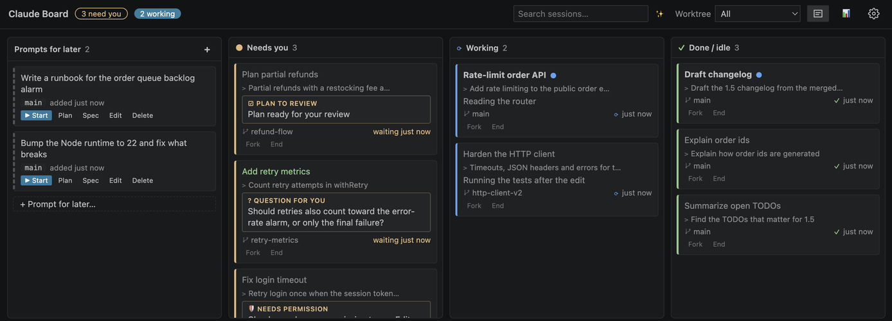

Open it with **DevDesk: Open Claude Board**, the board icon in the Claude view, or the colored board button at the top right of any editor group (next to editor buttons such as Claude Code's). Turn that button off with `devdesk.board.editorTitleButton`. **Ctrl+Cmd+B** (**Ctrl+Alt+Shift+B** on Windows and Linux, command **DevDesk: Focus Claude Board Prompt**) opens the board from anywhere, with the cursor in its prompt box. Change the key in **Keyboard Shortcuts** (search `devdesk.board.focusPrompt`).

The board is an editor tab, in the editor area where the Claude terminals open. It shows every session the Claude view lists, as one card per session, in lanes by state.

### Lanes

| Lane | Sessions in it |
|---|---|
| Prompts for later | Prompts you saved. They run only when you start them. See [Prompts for later](#11-prompts-for-later). |
| Needs you | A question, a permission prompt, a plan to review, or any other input. |
| Working | Working, stuck, or waiting on background work it started. |
| Done / idle | Done (including done with a question, and interrupted), blocked by an error or a usage limit, or crashed. Under an *Idle / stopped* divider: ready (not prompted yet), done longer ago than the idle time (`devdesk.sessions.idleMinutes`), not running, parked, or no status, once you've read them. |

Cards move between lanes by themselves. You can't drag them. Within a lane, cards are in the same order as the Claude view, with the same colors. An unread card stays above the divider until you read it.

### Cards

A card is kept short. It shows:

- a title: what the whole session sets out to do, its objective (`devdesk.board.cardTitle`, `objective`, a prototype). Insights write it (section 12), from the session's first prompts and the latest one. A name you gave with `/rename` wins.
- under it, in smaller text, the latest step: a few words on what the latest prompt is about. With `devdesk.board.cardTitle` set to `latest`, this is the title, and there is no line under it. Until insights have a title, the card shows Claude's own title or the last prompt.
- its worktree, and how long ago it changed. The card's color edge and a small icon show the state.
- a model name, if the board started the session with a model other than Default.
- its buttons: **Fork** and **End**.

In *Working*, a card also says what Claude is doing now, in one line (the insights live status, else the latest status).

A card also shows the note Claude set on it with `devdesk note` (📌), in any lane (see [The devdesk command](#16-the-devdesk-command)).

A card shows the ticket linked to its session or its worktree as a chip (🎫 `ABC-123 · In progress`) next to the worktree: click it to open the ticket (see [Link a ticket](#link-a-ticket)).

A worker session's card says whose worker it is and how it stands (👥 `worker "lint" · working · of Split the refactor`), and its coordinator's card counts its workers (👥 `3 workers: 1 done, 2 working`); see [Coordinator and worker sessions](#coordinator-and-worker-sessions).

In *Needs you*, a card also says what Claude asks or wants you to approve, in one line, under the kind of ask (question, permission, plan). Its time says how long it has been waiting.

**☰** in the header hides or shows these lines (`devdesk.board.cardLine`).

Unread cards have a bold title and a `●`. Read cards have a gray title. This is the same read state as the Claude view.

Hover a card (or move to it with the keyboard) for the rest. The hover opens at once and shows the title, what Claude is doing now, where the work stands (the insights summary), Claude's latest recap, the last prompt, the latest status, and when and where the session runs.

To act on a card:

- **Double-click** it, or press **Enter**, to open its terminal.
- **Fork** and **End** work as in the Claude view.

### Header

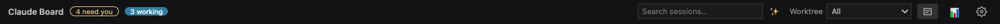

- The counts show how many sessions need you or are working.
- **Worktree** shows only one worktree's cards. The counts then count only those. Each project folder keeps its own choice, as it keeps its search.
- **☰** shows or hides the one line on *Working* and *Needs you* cards.
- **📊** shows token usage. See [Token usage](#13-token-usage).
- **⚙** opens the board's settings.

### Searching the board

Type in **Search sessions…** at the top of the board (⌘F / Ctrl+F) to filter the lanes as you type. Every word must
appear somewhere on the card: its title, prompt, Claude's recap, what Claude is doing or asks, the worktree, the state
or the model. `wt:<name>` matches the worktree only and `is:<state>` the state only (`is:needs`, `is:parked`). Parked
sessions the board leaves off (`devdesk.sessions.finishedSessions`) are searched too. Esc clears the search. The search
stays for the project folder, as the box's text does (after a reload or the tab closed).

Press **Enter** (or click ✨) to ask a model instead. It reads a short digest of each session (title, state, how long
ago, recap, and your latest prompts) and finds the ones your words are about, such as "the flaky test one" or
"what I parked yesterday". The lanes show its matches in their usual order, each with the model's reason. The call
runs in the background with `claude -p --bare` and your own Claude login (`devdesk.boardSearch.model`, Haiku by
default), never in your sessions. The same answer is reused for 5 minutes.

#### Your own model

Set `devdesk.boardSearch.command` to a program or script (with arguments) that answers instead, for example a script
around a local model. DevDesk runs it as `exec <command>` in a login shell, so pipes or `;` need a wrapper script (as
the `DEVELOPING.md` example is). It gets the search as JSON on stdin:

    { "instructions": "…what to do and how to answer…", "query": "the flaky one", "now": "2026-11-02T12:00:00.000Z",
      "sessions": [ { "id": "…", "title": "…", "worktree": "…", "state": "Needs you: QUESTION FOR YOU", "ago": "5m",
                      "model": "…", "recap": "…", "insight": "…", "ask": "…", "prompts": ["…"], "found": "…" } ] }

and prints `{"matches":[{"id":"<a session id>","reason":"<why>"}],"note":"<optional>"}` on stdout. Ids it did not get
are ignored. `DEVELOPING.md` has an example for Ollama.

#### Past sessions

The search also looks through this workspace's past Claude sessions, the ones no longer on the board. While you type,
the best matches show in a **Found in history** lane, newest first, with the matching words marked; ✨ can pick them
too. `wt:<name>` matches a past session's worktree (the one it was started in, or the folder name of a removed one),
and `is:history` keeps only past sessions. Lanes the query leaves empty fold to their heading, so the history lane
fits. **▶ Resume** (or Enter on the card) continues the conversation in tmux in the folder it was started in; **Fork**
starts a copy; **Copy id** copies its session id (for `claude --resume <id>`). If its folder is gone (a removed
worktree), the board offers to fork it in the workspace root.

The same index searches the whole conversation of the sessions on the board, not only what their cards show: a card
whose prompts or replies have every word you typed stays in its lane, with the matching words under its title (a ticket
URL you pasted hours ago finds its session). `wt:` and `is:` go by the card. ✨ is told where each board session has
the words too (`found` above).

DevDesk keeps an index of your prompts, Claude's replies and the files it edited, on this machine, readable only by
you, in `<devdesk.sessions.stateDir>/history`. It keeps up to about 64 KB of text per session, so with many sessions
it reaches tens of MB. It is updated at most once a minute while the board is open; while it is being built, the lane
says **Indexing history…** with how far it got. Tool output is not indexed. `devdesk.boardSearch.history` turns it
off, `devdesk.boardSearch.historyScope` searches every folder's sessions, `devdesk.boardSearch.historyDays` sets how
far back, `devdesk.boardSearch.historyMaxSessions` how many sessions at most (the newest 5000), and
`devdesk.boardSearch.historyDir` is where Claude's transcripts are read from (default: `projects` in Claude's config
directory). Each indexing run is logged in **Output → DevDesk** (`history: …`): how many transcripts, how many MB
were read, how long it took and what it did to the heap. If VS Code gets slow or its extension host restarts in a
folder where agents leave tens of thousands of transcripts, lower `historyMaxSessions` or turn `history` off.

### Open the board

- Run **DevDesk: Open Claude Board**, or click the board icon in the Claude view title bar.
- It opens the first time you open the Agent Sessions sidebar in a window (`devdesk.board.openWithSidebar`).
- It opens when the editor area has no tabs left (`devdesk.board.openWhenEmpty`). This doesn't happen right after you close the board itself.
- It comes back after a window reload.

### Sessions beside the board

On a wide screen, the first session you open from the board opens **beside** it. This happens when the board is alone in the editor area.

- The board stays on the left. It is just wide enough for every lane to show its cards' summaries: 220 px per lane (`devdesk.board.laneWidth`).
- The terminal takes the rest, on the right. The next sessions open there too.

DevDesk does this only when the terminal gets at least as much room as the board. Change it with `devdesk.board.sessionsBeside`:

| Value | Effect |
|---|---|
| `auto` (default) | Beside, when there is room. |
| `always` | Beside, even in narrow editor areas. |
| `never` | Sessions open over the board. |

## 9. The prompt box

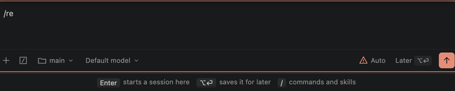

The board has a prompt box like the Claude Code panel's. It starts new sessions.

### Send a prompt

| Key | What it does |
|---|---|
| **Enter** | Starts a **new** session on what you typed. A prompt never goes to a running session. |
| **Option+Enter** (⌥⏎) | Saves it to *Prompts for later* instead. |
| **Shift+Enter** | Adds a line. |
| **⌥↑** in an empty box | Shows your previous prompt. Then **↑** / **↓** step through your history. |
| **Shift+Tab** | Cycles the launch mode. |

Plain **↑** also shows your previous prompt when the board has no cards, or when the box is on top.

After **Enter**, you stay on the board. The session runs in the background, and its card shows up in *Working*. Open it when you want. To open its terminal at once instead, set `devdesk.board.afterStart` to `session`.

If a session can't start, your prompt stays in the box. The reason shows next to the buttons.

### Footer controls

Left to right:

| Control | What it does |
|---|---|
| **+** | *Attach file…* (mentions each file you pick with `@`), *Mention a file*, or *Skill or command*. |
| **/** | Lists commands and skills. See [Slash commands](#10-slash-commands-in-the-prompt-box). |
| Folder (**main**) | Where the session starts: *main*, an existing worktree, or *New worktree…* with a name you type. A new worktree is made like New Worktree Session makes it. |
| **Model** | The model, the effort and Ultracode. See below. |
| **Mode** | The launch mode, from `devdesk.sessions.modes`. It starts at `devdesk.sessions.defaultMode`. |
| **Later ⌥⏎** | Saves the prompt to *Prompts for later*, with the model, effort, Ultracode and mode you chose. |
| **↑** | Starts the session. |

The box's border and send button take the mode's color, as in Claude Code.

DevDesk remembers the model, effort, Ultracode and mode **for each project folder** (the folder open in the window, on that machine). Once you pick one in a project, that project keeps it until you change it: after a reload, after you close the board's tab, and in another window on the same folder. A project where you never picked one starts with the defaults: the mode in `devdesk.sessions.defaultMode`, the first model in the list (`devdesk.board.models`, else *Default*), *Default* effort, Ultracode off. Choices you change while editing a prompt for later belong to that prompt only. DevDesk doesn't remember where the session starts: that goes back to *main* after you send.

The text you typed and haven't sent, and your previous prompts for **⌥↑** (the last 50), are kept per project folder too, the same way.

### Files and images

- Type `@` to pick files in the folder the session starts in.
- Paste an image (⌘V) to add it. DevDesk saves it in `devdesk.board.pastedImagesDir` and mentions it with `@`, so Claude sees it.

### Model, effort and Ultracode

The **Model** menu has three parts:

- **The model.** The list comes from the Claude CLI, with each model's name and description, so 1M and 200K context differ. DevDesk passes it as `--model`. Set `devdesk.board.models` to replace the list.
- **The effort**, if the model supports it. DevDesk passes it as `--effort`.
- **Ultracode.** It adds `ultracode` to the prompt, so Claude runs dynamic workflows.

These choices apply to the next session the board starts. DevDesk never saves them to your Claude settings.

More details:

- The full model list takes a moment to load. Until it does, the menu shows Claude's short names (`opus`, `sonnet`, …). A short name you pick stays selected after the full list loads, in the box and in prompts for later. It doesn't get a row of its own.
- Picking a model resets the effort to Default if that model doesn't offer it.
- Some models have no effort levels, such as a Bedrock prompt router (a model id that picks a model for each request). They show no effort.

### Pick a model or effort by typing

| You type | What happens | Example |
|---|---|---|
| `/model` | Opens the model list. | |
| `/model` + a model's id or name | Picks that model. | `/model opus 1m` picks Opus (1M context). `/model default` or `/model Model` (what the pill shows for it) picks Default. |
| `/model` + the start of several names | Lists the models that match. | `/model auto` |
| `/model` + a `[1m]` alias | Picks its model's 1M-context row. | `/model opus[1m]` |
| `/model` + another Claude alias, or a model Claude doesn't list | Uses it as typed. | `/model opusplan` |
| `/effort` | Opens the effort row. | |
| `/effort` + a level | Picks a level the model offers. `auto` means Default (no `--effort`). | `/effort high` |
| `/effort status` | Shows the choices. | |
| `/effort ultracode` | Turns Ultracode on or off. Add `on` or `off` to set it. | `/effort ultracode on` |

A model you type this way gets a row in the list from then on, also after a reload. To clear these rows, pick **Forget typed models** at the end of the list.

If you set `devdesk.board.models`, the list shows only those models. A model you type is still used, but it doesn't get a row.

### Prompt box placement

By default, the prompt box sits under the lanes. Its popups open upward, over the lanes.

Set `devdesk.board.promptPlacement` to `top` to put it above the lanes. Then:

- it grows down into the board,
- its popups open downward,
- **↓** goes to the cards (instead of **↑**).

The box is three lines tall. A long prompt grows it into the board, up to 60% of the window. Then it scrolls.

A line under the box says which keys do what.

### The New Session box in the sidebar

The **New Session** view, at the top of the Agent Sessions panel above the Claude view, is the same prompt box without
the board around it. It has the same choices (where it runs, model and effort, permission mode, Later), `/` commands
and skills, `@` files and pasted images, and it remembers the same choices and earlier prompts. Its draft is its own.

- **Enter** starts the session, **⌥⏎** saves it for later (to the board's *Prompts for later*).
- **←**, or **↓** in an empty box, goes to the Claude view under it.
- The board button in its title bar opens the Claude Board; the gear opens the board's settings.
- Drag its lower edge to make it taller (its popups open downward, into the view).

To hide it, turn off `devdesk.board.sidebarPrompt`. It goes away (and comes back) at once.

## 10. Slash commands in the prompt box

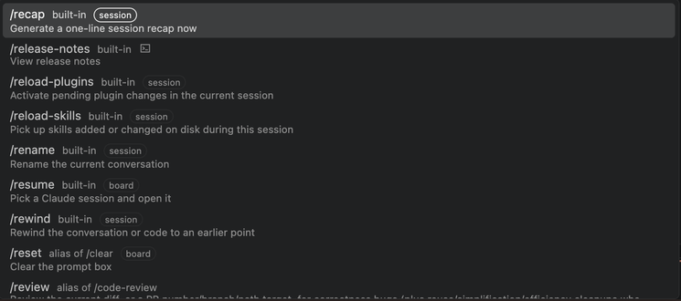

### The / menu

Type `/` at the start of the prompt, or click **/**. The menu lists every command Claude Code has in that folder:

- built-ins, such as `/plugin`, `/mcp`, `/agents` and `/model`,
- bundled skills,
- your skills, the project's skills and installed plugins' skills (`plugin:name`).

DevDesk asks the Claude CLI (`devdesk.sessions.claudePath`) for this list. It asks when the board opens and every 5 minutes. It uses no hooks and no model call.

- If the CLI doesn't answer, DevDesk reads your skill and command folders instead.
- A skill or command you add to those folders appears in the menu right away. You don't have to wait for the CLI's next answer. It also runs right away.

Commands that load late, such as MCP and plugin prompts, show up while the menu is open.

### Search and pick

- Typing matches names and aliases by the start of any word. It ignores `:`, `_` and `-`.
- Aliases show as *alias of …*. For example, `/cost` shows as *alias of /usage*.
- Among equally good matches, built-ins that run come before *unavailable* ones. So `/mo` **Enter** runs `/model`.
- **↑** / **↓** move, and wrap around. **Escape** closes.
- **Tab** puts `/name ` in the box and shows its arguments under it, until you type one.
- **Enter** does the same as Tab, with two exceptions:
  - A *board*, *session* or terminal command that needs no argument runs at once.
  - An *unavailable* command makes the box say why at once.

Claude Code's internal commands are never listed. Some commands are turned off in the Claude Code that the Builder Toolbox installs, such as `/login`. They show only when you type their full name.

### Skills in the middle of a prompt

After a skill, `/` opens the menu again, because skills stack: `/skill-a /skill-b text`, up to six.

A `/` after a space in the middle of the text also opens the menu, with skills only. Example: `fix the bug then /simp`. Claude Code runs a skill named there. When nothing matches (a path such as `/tmp`), no menu opens.

The menu doesn't open after a built-in the board handles at the start, such as `/model …`.

### What the board does with each built-in

Each built-in in the menu has a tag:

| Tag | What happens |
|---|---|
| *board* | The box handles it itself. |
| *session* | DevDesk sends it to a running session you pick. |
| terminal icon | It opens a panel in a session. The session's terminal opens so you can use it. |
| *unavailable* | It does nothing. The box says why if you send it. |

#### board: handled by the box

| Command | What it does |
|---|---|
| `/help` | Lists the box's commands and what it does with each. `/help <command>` explains one. |
| `/clear` (`/new`, `/reset`) | Empties the box. Text after it isn't sent, and the box says so. A saved `/clear <text>` started from its card stays in Prompts for later. |
| `/resume` (`/continue`) | Picks one of the board's sessions in tmux and opens it. `/resume <words>` lists only sessions whose title, prompt, worktree or ids hold those words. If only one matches, it opens at once. |
| `/model`, `/effort` | See [Pick a model or effort by typing](#pick-a-model-or-effort-by-typing). |
| `/plan <task>` | Starts a new session on the task in plan mode. See below. |
| `/add-dir <path>` | Lets the next session also work in an existing directory. See below. |

**`/plan <task>`** uses the mode in `devdesk.sessions.modes` whose arguments plan. If there is none, it uses `--permission-mode plan`. It starts without Ultracode or Spec. The task may be a skill (`/plan /simplify the auth module`), but not another command. A bare `/plan` asks for a task.

**`/add-dir <path>`** adds `--add-dir` to the next session.

- `~` is your home directory.
- A relative path is taken from where the session will run. So it is refused for a new worktree, which doesn't exist yet.
- The directory shows as a chip in the box until the session starts. Its × removes it.

#### session: sent to a running session

These commands act on a conversation: `/compact`, `/context`, `/usage` (`/cost`, `/stats`), `/status`, `/rename`, `/color`, `/goal`, `/btw`, `/fork`, `/subtask`, `/mcp`, `/output-style`, `/reload-skills`, `/reload-plugins`, `/recap`, `/rewind`, `/export`, `/copy`, `/diff`, `/autocompact` and `/list-agents` (`/peers`).

When you press Enter:

1. You pick a running session. The list shows main's and the worktrees' sessions, with their title and state. Sessions in the folder selected in the footer come first. Parked and ended sessions aren't listed: the box doesn't resume a session to send it a command.
2. DevDesk pastes the command, as written and on one line, into that session's terminal, then presses Enter once Claude has taken the paste in (`devdesk.board.pasteSettleMs`). As a paste, nothing in it is read as a key, however long it is.

DevDesk sends it only when all of these are true:

- Claude waits at an empty prompt.
- The pane isn't scrolled back (tmux copy mode).
- Claude isn't working. `/btw`, `/usage`, `/context` and `/status` are the exception: they can be sent while it works.

Otherwise the command stays in the box. The box says why and offers **Open session** and **Try again**.

After sending, **Open session** shows what Claude answered. After `/reload-skills` or `/reload-plugins`, the `/` menu asks Claude for its list again.

#### terminal icon: opens a panel in a session

These commands only open a panel in Claude's terminal: `/permissions`, `/hooks`, `/memory`, `/skills`, `/tasks`, `/theme`, `/config`, `/plugin`, `/keybindings`, `/sandbox`, `/agents`, `/ide`, `/privacy-settings`, `/focus`, `/tui`, `/release-notes`, `/branch`, `/import` and `/advisor`.

The box asks which session runs them:

- **New session**: starts where the box starts sessions, without Ultracode. If that is *New worktree…*, it starts in main.
- A running session: those in that folder come first. DevDesk types the command into its prompt, but only while that prompt is empty. Otherwise the box says why and keeps the command.

Either way, the session's terminal opens so you can use the panel. This ignores `devdesk.board.afterStart`.

`/config model=…` and `/config effortLevel=…` (or `/settings …`) don't run. They would save the model or effort to your Claude settings. The box tells you to use `/model` or `/effort`, which set them for the next launch only.

#### unavailable: starts nothing

These start nothing. The box says why and keeps your text.

- Commands that make no sense from the board: `/login`, `/logout`, `/upgrade`, `/exit`, `/restart`, `/terminal-setup`, the setup commands, `/cd`, `/background` (`/bg`), `/workflows`, and others.
- Commands Claude Code removed: `/vim`, `/pr-comments`.
- Commands unavailable on Bedrock: `/fast`, `/design`.

### Unknown commands

A `/name` that is no command, skill or plugin prompt Claude knows starts nothing either. The box warns you. **Send as text anyway** starts a session on it as typed. That costs a model turn.

If you change the folder, model, effort or mode, the warning closes. Press Enter again to send with your new choices. This way a session never starts with choices the box no longer shows.

The box calls a name unknown only after Claude has listed its commands for that folder. Until then, it waits for the list. Sometimes Claude can't list them: it doesn't answer, or VS Code doesn't trust the workspace. Then Claude's bundled skills and MCP prompts get the warning too.

### Ultracode and commands

Ultracode applies only to prompts and skills. It never applies to a command the board handles, such as `/model` or `/effort`. The same is true for **Spec**; see [Prompts for later](#11-prompts-for-later).

### Untrusted folders

Before a session starts in a folder Claude hasn't trusted yet, the box says Claude will ask first. The session opens so you can answer. DevDesk reads trust from `devdesk.board.claudeConfigFile`. It writes there only to trust a worktree it just made (see [Trust for new worktrees](#trust-for-new-worktrees)).

## 11. Prompts for later

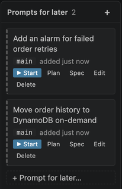

A prompt for later is a prompt you saved to run later. It doesn't run until you click one of its buttons.

### Save a prompt for later

Any of these focuses the prompt box in *Later* mode, where **Enter** saves:

- **+** on the lane,
- *+ Prompt for later…* at the bottom of the lane,
- **DevDesk: Prompt for Later on Claude Board**.

You can also press **Option+Enter** (⌥⏎) or click **Later** in the prompt box.

### Run it

| Button | What it does |
|---|---|
| **▶ Start** | Runs it as saved. |
| **Plan** | Runs it in plan mode. Claude explores and presents a plan before it changes anything. |
| **Spec** | Runs it behind `devdesk.board.specPrompt`. See below. |
| **Draft** | Starts a session with it typed at Claude's prompt, not sent (Claude's `--prefill`), and opens the session. Edit it there, then press **Enter**. |

By default, **Spec** uses the brainstorming skill when it is installed. Otherwise it adds an instruction to write a design spec first and wait for your review. With a saved skill, such as `/simplify the auth module`, the instruction goes after the skill's name, so the skill still runs.

**Plan** and **Spec** apply only to prompts and skills. A saved command, such as `/plan <task>` or `/effort max`, runs as saved, as **▶ Start** would.

A prompt leaves the lane once it ran: its session started, or its command was sent or done.

### Edit or delete it

- **✎** (Edit), next to the prompt's worktree, puts it back in the prompt box. Send it (it then leaves the lane), save it again, or click **Cancel**.
- **✕** (Delete) asks first.

Prompts for later belong to the project folder (the folder open in the window, on that machine): each project has its own lane, and every window on that folder shares it. (Tasks saved by older versions show as their title followed by their notes.)

Versions before kept one list for all the projects on a machine. When a project folder opens with this version, it takes from that list the prompts saved for one of its worktrees, and the ones that don't say which project they're for (saved for *main*, a new worktree, or a worktree since removed). Prompts saved for another project's worktree stay for that project. Each prompt moves to exactly one project. A window with no folder open keeps using the machine's list, and the next project folder that opens takes its prompts.

## 12. Insights

Insights use a small model to describe each session. They are on by default (`devdesk.insights.enabled`). The model is Haiku (`devdesk.insights.model`).

Insights add these things:

- **A short title** for each session, used in the Claude view and on the board.
- **A live status line** on working rows, on *Working* cards and in the card's hover. It refreshes after new activity, at most every 45 seconds (`devdesk.insights.refreshSeconds`).
- **A short summary** of where the work stands, in the card's hover.
- **What Claude asks you**, in one line, on *Needs you* cards. It is written once per wait.
- **Whether a finished turn waits for you.** This gives the speech-bubbles icon.

### How a call works

Each call is a separate `claude -p --bare` run:

- It uses your Claude login.
- It runs in the temp directory.
- It sends about 100 tokens plus the end of the transcript.
- It has no tools, no hooks and no CLAUDE.md, and saves nothing.

Your sessions are never touched.

Calls run in VS Code, so only while a window with DevDesk Claude is open. Answers are kept in `insights/` in `devdesk.sessions.stateDir`. Every window reads them, and only one window makes each call. At most 5 calls run at once (`devdesk.insights.maxConcurrent`).

If a call fails, the card shows what it would show without insights.

## 13. Token usage

### The 📊 popup

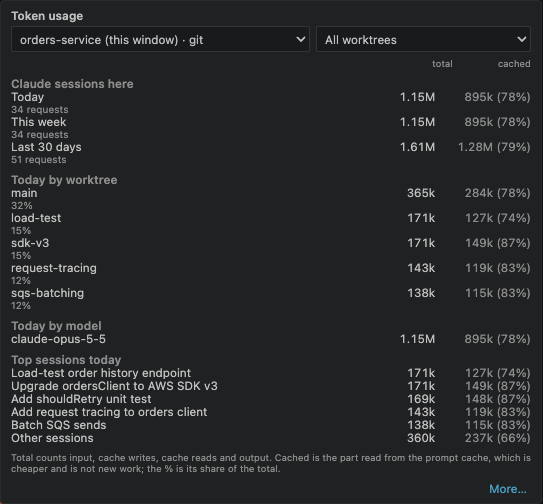

**📊** in the board header shows tokens used by your Claude sessions:

- **today**,
- **this week** (from Monday),
- **the last 30 days**.

It starts on this window's project ([By project](#by-project)). Two selects at its top choose what it counts:

- **Project**: this window's project, *All projects*, then the other projects used in the last 30 days.
- **Worktree**: *All worktrees* or one of them. It shows when the project has more than one worktree.

For today, it also shows tokens per model and the top 5 sessions, and **Today by project** (under *All projects*) or **Today by worktree** (for a project with more than one). Click a row there to narrow the popup to that project or worktree. Under *All projects* it also counts DevDesk's own insight calls, as **DevDesk insights**; a project never includes them.

DevDesk reads every transcript under `~/.claude/projects`, subagents included. It counts each request once.

Each line has:

- a **total**: input, cache writes, cache reads and output;
- how much of it was **cached**, with its share, such as `63M (55%)`. Cached tokens are read from the prompt cache. They are cheaper, and are not new work.

DevDesk logs its own calls in `usage.jsonl` in `devdesk.sessions.stateDir`. The tokens per model list them apart from your sessions' models, as `<model> (DevDesk)`, for example `claude-haiku-5-5 (DevDesk)`. Days counted before v0.5.35 don't have this row.

Claude Code makes a few small calls of its own (for example, to name a session) that it doesn't write to the transcripts. DevDesk can't count those.

### Plan limits

With a Claude.ai Pro or Max subscription, the top of the popup shows how much of your plan's limits you've used, for your whole account:

- **5-hour**: the share of the 5-hour limit used, and when it resets (`resets in 2 h 5 min`).
- **Weekly**: the same for the 7-day limit.

Hover over a row to see the reset time as a date. When the numbers are more than a minute old, the title says how old (`as of 7 min ago`). A window whose reset time has passed is left out until Claude replies again.

Claude Code gives these numbers only to its status line command, not to hooks or transcripts. So DevDesk shows them once its own status line is installed. Click **Show…** in the popup, or run **DevDesk: Show Claude Plan Limits (Install DevDesk's Status Line)**. After you confirm, DevDesk:

- copies `devdesk_statusline.py` to the `devdesk` folder of Claude's config directory and makes it the `statusLine` command in `settings.json` (after a backup);
- keeps your own status line, if you had one, inside that command (as `u='…'`), along with its other keys, such as `refreshInterval`.

On each update, the script writes the numbers to `rate-limits.json` in `devdesk.sessions.stateDir` (at most every 15 seconds while they stay the same). Then it runs your status line with the same input, so your terminal shows what it showed before. Without one, it prints the model, the context used and the limits, such as `Opus 5.5 · context 4% · 5h 42% · 7d 18%`. If the script or `python3` is missing, your own status line runs alone.

**DevDesk: Remove DevDesk's Claude Status Line** puts back the status line you had, or none. A project's own `.claude/settings.json` with a `statusLine` overrides DevDesk's there.

With an API key or a cloud provider (such as Amazon Bedrock), Claude Code reports no plan limits, and the popup shows none. Turn off `devdesk.usage.planLimits` to hide the **Show…** offer too.

### The Claude Usage page

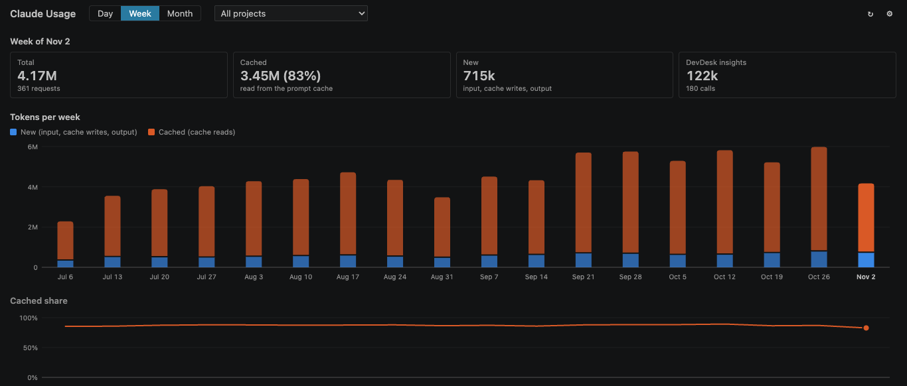

Click **More…** in the popup, or run **DevDesk: Show Claude Token Usage**. The **Claude Usage** page shows tokens:

- by **day** (last 30),
- by **week** (last 26),
- by **month** (last 24).

At the top, the page shows your plan limits, as the popup does (the same rows, the same **Show…** offer, and nothing without numbers or with `devdesk.usage.planLimits` off). Plan limits are for your whole Claude account, whatever project you choose.

Each column shows new and cached tokens. A line shows the cached share. Click a column to see that period's totals, models and top sessions. Open *Every day as a table* to see the numbers.

The header has the popup's **Project** and **Worktree** selects. Below the charts, **Projects** (under *All projects*) or **Worktrees** (for one project) splits the selected period by project or worktree. Under *All projects*, *Every day as a table* has a row per day and project. Click a column title in that table to sort by it, and again to reverse.

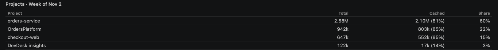

### By project

Each request counts where its session ran: the folder its transcript records. Folders are grouped as the board groups them:

- a **git repository**, with its worktrees (Claude Code's `.claude/worktrees/*` and `git worktree add` ones);
- a **plain folder**.

A worktree deleted since still counts under its project, by its path: a Claude Code worktree, or a `git worktree add` one that was in its repository's `.worktrees/` or `worktrees/` folder. Any other deleted folder in a repository counts under its `main`.

The choice of project and worktree is kept per window, and the popup and the page share it. `devdesk.usage.defaultScope` sets what they show first: this window's project (`project`), or all projects (`all`).

- **Unknown project**: requests whose transcript records no folder, and days counted before DevDesk counted projects. Once, after the upgrade, DevDesk counts those days again from what is left of their transcripts (about the last 30 days). This reads them all, like the first count. A day whose transcripts are gone, all or in part, keeps its old totals, as the Unknown project.
- **Other projects**: each day keeps its top 30 projects and worktrees; the rest are summed.

### History

Claude Code deletes transcripts after 30 days (`cleanupPeriodDays`). So DevDesk keeps each finished day in `usage-history.jsonl`, in `devdesk.sessions.stateDir`.

- Each day takes a few KB: its top 20 sessions by name, and the rest summed.
- It keeps 365 days (`devdesk.usage.historyDays`) and at most 10 MB (`devdesk.usage.historyMaxMB`). Past either limit, the oldest days go first. Every window prunes the same file, so both are machine settings (User or Remote settings, not a folder's).
- The page's footer shows how much it holds.
- Once days are in the history, `usage.jsonl` is trimmed to the last two days when it passes 2 MB.

The first count reads every transcript, which can take a while (tens of GB on a busy machine). It runs off the extension host, so VS Code stays responsive, and the page shows how much it has read. Each day is saved as soon as it is counted, so closing the window keeps the work done and the next count goes on from there. Later counts read only what changed.

## 14. Keyboard navigation

There are three places:

- a session's **Claude terminal**,
- the **Claude view** in the sidebar,
- the **Claude Board**.

**←** takes you left, toward the sidebar. **→** brings you back to the board, always into its prompt box, and opens the board if it is closed. **Ctrl+Cmd+B** does the same from anywhere. From the box, **↑** takes you into the cards.

| Where you are | Key | Goes to |
|---|---|---|
| Claude terminal, empty prompt | **←** | Claude view, on that session's row. With text in the prompt, **←** moves the cursor. |
| Claude view | **→** | The board's prompt box. Opens the board if it is closed. |
| Anywhere | **Ctrl+Cmd+B** (**Ctrl+Alt+Shift+B** on Windows and Linux) | The board's prompt box. Opens the board if it is closed. |
| Prompt box, empty | **←** | Claude view. |
| Prompt box, empty | **↑** (**↓** if the box is on top) | The card you were last on, else the first session. |
| Card | **↑** / **↓** | The card above or below in its lane. Past the card nearest the box, back to the box. |
| Card | **←** / **→** | The nearest card in the next lane. **←** from the leftmost lane goes to the Claude view, on that session's row. |
| Card | **Home** / **End** | The lane's first or last card. |
| Card | **Enter** | Opens the session. |
| Card | **Tab** | The card's buttons (a prompt for later's ▶ Start, Edit, …). |
| Card | **Esc** | Back to the prompt box, as you left it. |

The arrows move between places only from an empty prompt box. With text in it, **←**, **↑** and **⌥↑** move the cursor. That's why the hint under the box lists these keys only while the box is empty.

### How ← works in a Claude terminal

The Claude view stands in for Claude Code's own agent view. In Claude Code, ← on an empty prompt backgrounds the session and opens its agent view. In a DevDesk Claude terminal, it moves focus to the Claude view instead. Anywhere else in the prompt, ← moves the cursor as usual.

To make this work, DevDesk does three things:

- It reads the prompt from the session's tmux pane, to tell an empty prompt apart.
- It starts sessions with `CLAUDE_CODE_DISABLE_AGENT_VIEW=1`, so ← can't background them from a plain terminal either. This also turns off `/background` and `--bg` in those sessions.
- It adds its command `devdesk.sessions.leftArrow` to your `terminal.integrated.commandsToSkipShell` user setting. Without that, VS Code sends ← to the shell.

To keep **←** for Claude, set `devdesk.sessions.leftArrowOpensSidebar` to `false`. DevDesk removes its entry, and sessions started afterwards keep agent view. The setting can differ between folders: a window where it is off ignores the entry, and a window where it is on adds it back if it is missing.

## 15. tmux and terminals

### DevDesk's own tmux server

DevDesk starts its sessions on a separate tmux server: `tmux -L devdesk` (setting `devdesk.sessions.tmuxServer`). So they never mix with your own tmux sessions.

- To attach to one from a shell: `tmux -L devdesk attach -t cc-main`.
- `tmux ls` still shows only your own sessions.

### tmux settings

| Setting | What it sets |
|---|---|
| `devdesk.sessions.tmuxPath` | The tmux binary. |
| `devdesk.sessions.tmuxConfigFile` | A config file, loaded with `-f` when DevDesk's tmux server starts. Empty: DevDesk's sanitized copy of your config (below). |
| `devdesk.sessions.tmuxOptions` | Options such as `mouse` or `history-limit`. DevDesk sets them on each session when its terminal opens. |

### Your tmux config in DevDesk's sessions

DevDesk's tmux server loads a config of its own, `tmux.conf` in `devdesk.sessions.stateDir`. DevDesk writes it each time it starts, so an install or update brings it up to date. It loads your tmux config the way tmux would (`/etc/tmux.conf`, `~/.tmux.conf`, `~/.config/tmux/tmux.conf`), so your key bindings, options and theme still apply. Then it unsets every hook (`set-hook`).

A hook also runs for DevDesk's own clients: its VS Code terminals, the Claude Board and the phone. When a hook's `run-shell` fails, tmux shows the error over the pane. For example, a `session-window-changed` hook that expects `#{client_tty}` fails when the phone switches windows, and the board then shows `'…' returned 1`. Your own tmux server (plain `tmux`) still loads your config with its hooks.

When DevDesk starts, it also unsets the hooks of a DevDesk server that is already running. To load your own file instead, hooks included, set `devdesk.sessions.tmuxConfigFile`, then restart the server (`tmux -L devdesk kill-server`, which stops every DevDesk session). With `devdesk.sessions.tmuxServer` set to `default`, DevDesk shares your own server and changes nothing in it.

### Smooth scrolling (experimental)

With tmux's `mouse` on, tmux scrolls a Claude terminal itself, and each wheel event jumps 5 lines. Turn on `devdesk.sessions.smoothScroll` to have each wheel event scroll `devdesk.sessions.smoothScrollLines` lines (3 by default) one line at a time instead, which is closer to VS Code's own terminal. It still scrolls in whole lines.

Scrolling slowly with smooth scrolling on is precise, but a long way back takes many wheel turns. `devdesk.sessions.smoothScrollAcceleration` (on by default) makes fast scrolling go further: DevDesk counts the wheel events of the last 0.15 seconds, and from 4, 8 or 12 of them each further event jumps 2, 4 or 6 times `devdesk.sessions.smoothScrollLines` lines at once. A slow scroll stays one line at a time.

The setting changes the wheel bindings of DevDesk's tmux server, so it applies to all its sessions, in every window, as soon as you change it. DevDesk first saves the wheel bindings it replaces (tmux's defaults, or your own from a tmux config file), and turning the setting off loads them back.

### Install tmux

When tmux can't run, DevDesk offers **Install tmux**. It runs `devdesk.sessions.tmuxInstallCommand` in a terminal. The default is `sudo yum install -y tmux`, or `brew install tmux` on macOS. It is also in the command palette as *Worktrees: Install tmux*.

### Terminals after a reload

After a reload, VS Code would bring Claude terminals back as plain shells. So DevDesk tells VS Code not to restore them, and reopens them itself. This happens after:

- a window reload,
- a Remote-SSH reconnect that restarted VS Code on the remote machine.

Each terminal attaches again to its tmux session. If DevDesk parked that session while no window showed it, DevDesk resumes it there first, so the terminal comes back with its conversation. Sessions you ended or that crashed aren't resumed. To turn this off, set `devdesk.sessions.restoreTerminals` to `false`.

### Terminal tab titles

A Claude terminal's tab shows the session's title from the board card, so the tab you open looks like the card you just read: your `/rename`, else DevDesk's short title, else Claude's title or the prompt. Until the session has a title, the tab shows its name (`main-39`). Two sessions with the same title get their names added (`Fix login · main-39`).

Titles are cut to `devdesk.sessions.tabTitleLength` characters (24), so the tab row stays narrow. When a title changes, the tab follows the next time it is in front: VS Code only lets DevDesk rename the terminal in front. Set it to `0` to always show the session's name.

## 16. The devdesk command

Claude, running in a DevDesk session, can ask the VS Code window that shows the session to open a file or a diff, or to put a short note on its card. It does so with a small command, `~/.claude/devdesk/devdesk` (in Claude's config directory, `$CLAUDE_CONFIG_DIR` if set), which DevDesk writes and keeps up to date while `devdesk.cli.enabled` is on (the default). It needs `python3`.

```bash
devdesk open <file>[:<line>[:<column>]] [--focus]   # open a file, at a line and column
devdesk diff [<file>] [--focus]                      # diff a file against the Worktrees view's base; no file: every changed file of this worktree
devdesk note <text>                                  # a one-line note on this session's card on the board
devdesk note --clear                                 # remove it
devdesk ticket <key|url>                             # link the ticket this session works on (and its worktree, if it has none)
devdesk ticket                                       # print the linked ticket; --clear unlinks it
```

- What opens leaves the keyboard focus where it was, in Claude's terminal, unless `--focus`. `devdesk diff` with no file opens one multi-file diff editor, which VS Code puts in front.
- The diff compares against the base the Worktrees view uses (mainline or uncommitted), and you can leave notes for Claude on it (see [Leave notes for Claude on a diff](#leave-notes-for-claude-on-a-diff)).
- A note shows under the card's title (📌) and in its hover, and the board's search finds it. It belongs to the session's tmux pane, so it works only in a tmux session, and goes when the pane does.
- `devdesk ticket` links the ticket to the session (in a tmux session) and to its worktree when that has none, the way **Link Ticket…** does (see [Link a ticket](#link-a-ticket)).
- The command prints what it did. When it can't, it says why on stderr and exits with status 1: for example, no VS Code window running DevDesk Claude v2 has that folder open.

### Tell Claude about it

Claude doesn't know the command until you tell it. Run **Claude: Teach Claude the devdesk Command (Install Skill)** from the command palette. It writes a Claude Code skill, `~/.claude/skills/devdesk/SKILL.md`, which tells Claude what the command does, when to use it (when you ask to see something, or once at the end of a task), and lets it run the command without asking. Sessions started after that know it. DevDesk keeps the skill up to date; **Claude: Remove the devdesk Skill** removes it. DevDesk never overwrites a `devdesk` skill you wrote yourself.

### Which window handles it

Every VS Code window with DevDesk Claude v2 writes a small record: the folders it shows, the tmux panes of its sessions, and when it was last in front. The command picks one window:

1. the one whose Claude view lists the session's tmux pane,
2. else the one whose folder (workspace root or worktree) holds the file most closely, or the folder the command runs in,
3. else, of those that tie, the one in front last.

A window that does neither never gets the request, for `note` and `worker` too. When no window fits, the command fails: it needs a DevDesk Claude v2 window with this folder (or worktree) open. DevDesk Claude v1 windows write no record, so a session in a v1 window gets this error even when a v2 window has another folder open.

Only that window gets the request, and it takes it once. Requests and answers are files in `~/.claude/devdesk/ipc`, a folder only you can open, and each window only acts on requests that carry its own random token. No network port is opened. This works on a remote machine too (over Remote-SSH), where the extension and Claude run on the same host.

Turn it off with `devdesk.cli.enabled`: the window then takes no requests, and the command says so.

### Coordinator and worker sessions

One Claude session (the coordinator) can split its task and start other Claude sessions (workers) on the parts, each in a worktree of its own, then get their reports back. The skill (see [Tell Claude about it](#tell-claude-about-it)) teaches Claude when and how; you can also ask for it ("split this into workers").

```bash
devdesk worker start --name <name> --task <text|@file> [--worktree new|current] [--base <ref>]
devdesk worker check                 # the workers' unread reports and questions (marks them read)
devdesk worker list                  # each worker's task id, name and status
devdesk worker reply --task <id> <answer>
devdesk worker done --task <id> --outcome succeeded|failed --summary <text>   # from a worker
devdesk worker ask --task <id> <question>                                     # from a worker
```

1. **Start.** `devdesk worker start` returns the worker's task id at once. In the background, DevDesk makes a worktree the way **New Worktree Session** does (a Claude Code worktree in a git repository, else `devdesk.worktrees.createCommand`), named after `--name`, and starts Claude there in a tmux session without opening its terminal. `--worktree current` starts it in the coordinator's folder instead (for read-only work, like a review). `--base <ref>` makes a git worktree from that commit (git repositories only). If the worktree or session can't be started, the coordinator gets a "failed to start" message. A worker can't start workers of its own, and one coordinator runs at most `devdesk.workers.maxConcurrent` (4) at once.
2. **The worker's first prompt** is its task, then what it is (a worker, with its task id and coordinator) and the exact `devdesk worker ask` and `devdesk worker done` commands to run.
3. **Reports and questions** go to the coordinator's mailbox: a file per coordinator, `workers/<tmux server>~<tmux session>.jsonl` in the sessions state directory (`devdesk.sessions.stateDir`), only ever appended to. Nothing is lost if VS Code is closed meanwhile: `devdesk worker check` prints whatever is unread when it runs.
4. **The nudge.** When the coordinator has unread messages and waits at an empty prompt (its turn over, nothing typed, no question or dialog open, its pane not scrolled back), DevDesk types one line into it: `You have 2 worker messages. Run devdesk worker check.` It does so once per batch: a new message makes a new notice. A busy coordinator is never interrupted; it is told when its turn ends. Turn this off with `devdesk.workers.nudge`.
5. **Answers.** `devdesk worker reply` types the answer into the worker as soon as it waits at its prompt.
6. **Silent workers.** A worker whose turn ended (or whose Claude exited) without `worker done` or `worker ask` for `devdesk.workers.escalationMinutes` (3) gets a "stopped without reporting" message sent to its coordinator, once each time it stops.

`devdesk worker list` and the board say where each worker stands: `starting`, `working`, `waiting` (on a permission or a question), `idle` (its turn ended, no report yet), `ended` (Claude no longer runs), or what it reported: `succeeded` or `failed`. The window that lists the coordinator's session does the nudging; two windows never type the same notice twice.

## 17. Web access from your phone

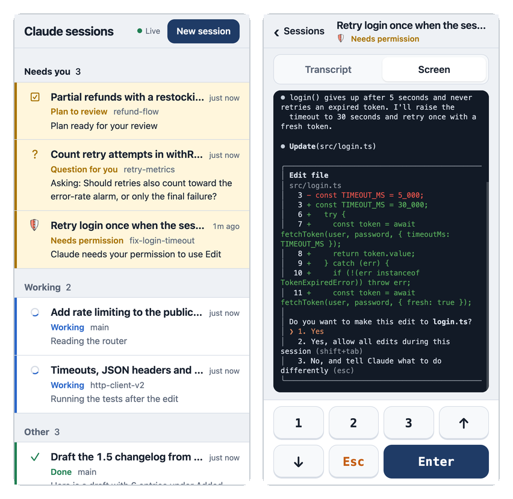

Web access is a page for your phone's browser. It shows your Claude sessions and lets you answer them, even when VS Code is closed or Remote-SSH drops. It works in a laptop browser too.

- **List**: the sessions that need you first, then the working ones, then the rest (see [How the list is ordered](#how-the-list-is-ordered)). Each shows its state, its worktree and what it is doing or asking.
- **Session**: two tabs. **Transcript** is the conversation: your last 40 prompts (marked `>`) and Claude's replies (marked `⏺`, with their tables, lists and code laid out). One grey line such as "Ran 3 tools: Bash, Read" stands for the tools Claude ran between them; tap it to see the calls. **Screen** is the session's terminal as it is now (**Terminal** with the [experimental terminal](#the-terminal-experimental)). Type a reply: as in the prompt box, **`/`** (or the **/** button) lists the commands, skills and plugin prompts you can run in the session, and one that needs nothing more (`/compact`, `/context`, `/permissions`) runs when you pick it. Commands that only the Claude Board runs (`/plan`, `/resume`) and blocked ones (`/exit`, `/login`) are left out. When Claude shows a dialog or a choice, the reply box gives way to the keys **1**, **2**, **3**, **↑**, **↓**, **Esc** and **Enter**. While Claude works, **Esc** interrupts it.
- **Start a session**: the prompt box on top of the list. Type what Claude should do, pick `main` or a worktree (main is picked), and tap **Start** (or press Cmd/Ctrl+Enter). The new session opens. The box works like the Claude Board's:
  - **`/`** (type it, or tap the **/** button, handy on a phone keyboard) lists the skills, plugin and project commands and built-ins Claude Code has in the chosen folder. Type to filter; ↑ ↓ and Tab or Enter pick. The list leaves out commands that need a running session (`/compact`, `/context`…); type one in that session's reply box instead.
  - **Mode, model and effort pills** under the prompt: the permission mode (from `devdesk.sessions.modes`, `devdesk.sessions.defaultMode` first), the model (the CLI's list, or `devdesk.board.models`) and the effort levels that model takes. A pill off its default is highlighted, and the browser remembers your picks. On a phone the pills show once you tap the box.
  - **`/model <name>`** and **`/effort <level>`** set the pills instead of starting; **`/plan <task>`** starts the task in plan mode; **`/clear`** empties the box. Interactive commands (`/permissions`, `/config`…) start a session that shows their panel.
- **Settings** (the ⚙ at the top): how this browser opens a session. **Default** follows `devdesk.web.sessionView` on your desktop; **Transcript** is the view above; **Terminal (experimental)** keeps it and swaps the Screen tab for a live terminal (below).

On a window 900 px wide or more, the list stays on the left and the open session fills the right, so you can switch sessions or start one without going back. It can't show the Claude Board or diffs, make worktrees, resume parked sessions, attach images, or mention files with `@`. With a mouse, the page uses smaller controls; a touch screen keeps the large ones.

### The terminal (experimental)

With **Terminal (experimental)** chosen, a session still opens on its **Transcript** with the reply box, and its second tab is **Terminal** instead of Screen: the live terminal, the same screen your desktop shows, and you type into it as you would there: slash commands with their menus, **Tab**, **Shift+Tab** to change mode, **Ctrl** keys, editing a prompt before you send it. A key bar above the keyboard has the keys a phone lacks: **Esc**, **Tab**, **⇧Tab**, **Ctrl** (for the next key), **^C**, the arrows and **Enter**.

- **The window takes the phone's size** while you use it there, so Claude's text fits the screen. Your desktop's view of that session shrinks too, until you type on the desktop: then the window takes the desktop's size back, and the phone's again when you type on the phone.
- **It connects only while the Terminal tab shows.** Going back to Transcript, leaving the session, locking the phone or switching apps closes the terminal (tap **Reconnect** to go on), and so do 10 minutes without typing. At most four terminals are open at once.
- **What you type goes only to that session's pane.** tmux's own keys (the prefix key, new windows) do nothing from the page. As in the session itself, Claude's `!` commands run in the shell, and **Ctrl+Z** suspends Claude and leaves you at the pane's shell.

It is experimental: tell us what doesn't work. Go back to **Transcript** in Settings at any time. A dialog shows its keys under the transcript; the page doesn't switch to the Terminal tab for it, as that would resize your desktop's window.

### How it works

- **A small server on the host that runs Claude.** **Start Web Access** starts it in the background: the *daemon*, `dist/web.js` on VS Code's own Node. It keeps running after VS Code closes.
- **It listens on `127.0.0.1` only.** No port opens on the host, and no setting changes that.
- **A proxy brings your phone to it.** The proxy (a *tunnel*) signs you in, gives the page an HTTPS URL, and tells the daemon who you are. The daemon checks that on every request and turns everyone else away. (Dev Tunnels is the exception: it tells DevDesk nothing, so its own sign-in is the only check.)
- **No passwords, no links with tokens.** Who you are comes from the proxy. Use web access only on a host no one else uses: see [Who can open it](#who-can-open-it).

### Set it up anywhere else

The first time you run **Start Web Access** with no tunnel set up, DevDesk asks how your phone should reach it. Run **DevDesk: Choose Web Access Tunnel** (or the plug button in the Web Access view's title bar) to change it later. The list says which tools are installed. For the one you pick, DevDesk checks that you are signed in (and opens a terminal to sign in if not), fills in who may use web access, saves `devdesk.web.tunnel` and the settings below, starts web access, and shows the QR code once the tunnel is up.

| `devdesk.web.tunnel` | Who can reach it | Who DevDesk lets in | What you need |
|---|---|---|---|
| `tailscale` (recommended) | Devices on your tailnet only; no public URL | The Tailscale login in `devdesk.web.allowedUsers` (from `Tailscale-User-Login`, which Serve sets and strips from what the browser sends) | Tailscale on this host and your phone, signed in to one tailnet, with HTTPS certificates on |
| `devtunnel` | Only the GitHub or Microsoft account that runs the tunnel | No one checked by DevDesk: Dev Tunnels names no one | The `devtunnel` CLI, signed in |
| `cloudflare` | Anyone, but Cloudflare Access asks them to sign in first | The email in `devdesk.web.allowedUsers`, from Access's signed token | A domain on Cloudflare, `cloudflared` signed in, and an Access application |
| `ngrok` | Anyone, but ngrok asks them to sign in first | The email in `devdesk.web.allowedUsers`, which ngrok's sign-in checks too | An ngrok account, its authtoken on this host |

What DevDesk runs for each (you don't type these: they come with the preset, and `devdesk.web.tunnelCommand` and `devdesk.web.identityHeader` don't apply):

- **Tailscale**: `tailscale serve {port}`, in the foreground, so serving stops with web access. The URL is `https://<machine>.<tailnet>.ts.net/`, and doesn't change. The first time, Tailscale may print a link to turn on HTTPS for your tailnet: DevDesk shows it with an **Open Link** button and waits up to 5 minutes. On Linux, let your user run Serve once with `sudo tailscale set --operator=$USER`. Don't use Tailscale Funnel: it puts the page on the public internet.
- **Dev Tunnels**: `devtunnel host -p {port}`, a temporary tunnel only you can open, deleted when it stops; its URL changes on each start. Dev Tunnels tells DevDesk nothing about the visitor, so DevDesk can't check again: the tunnel's own sign-in is the only check, and any process on this host can also use the page through `127.0.0.1`. DevDesk asks you to accept that once, and the daemon refuses to run a Dev Tunnels command with `--allow-anonymous`. Use it only on a machine no one else uses.
- **Cloudflare**: a named tunnel `devdesk-{host}` per machine (created the first time), a DNS record for `devdesk.web.publicHost` pointing at it, then `cloudflared tunnel run --url http://127.0.0.1:{port} devdesk-{host}`. First create a self-hosted [Access application](https://developers.cloudflare.com/cloudflare-one/applications/configure-apps/self-hosted-apps/) for that host name, with a policy that allows only your email. DevDesk asks for your team name (`<team>.cloudflareaccess.com`, saved in `devdesk.web.cloudflare.team`) and the application's AUD tag (`devdesk.web.cloudflare.audience`). The daemon then checks the token Access sends in `Cf-Access-Jwt-Assertion`: signed by one of your team's keys (fetched from `https://<team>.cloudflareaccess.com/cdn-cgi/access/certs`), for that application, not expired. It never trusts the `Cf-Access-Authenticated-User-Email` header alone, since without an Access application in front of the tunnel anyone could send it. Until the keys are fetched, or with the team or AUD tag missing, every request is denied.
- **ngrok**: `ngrok http 127.0.0.1:{port} --traffic-policy-file <policy>` (plus `--url` with `devdesk.web.publicHost`, for a domain you reserved). DevDesk writes the policy to `web-v2/ngrok-policy.yml` (private to you): visitors sign in with `devdesk.web.ngrok.oauthProvider` (Google by default); anyone whose email isn't in `devdesk.web.allowedUsers` is turned away by ngrok; the rest reach DevDesk with their email in `X-DevDesk-User` (any value the browser sent is removed first), which DevDesk checks again.

Check once, from a private window or a phone that isn't signed in, that the URL asks you to sign in (or, for Tailscale, doesn't open off your tailnet) before you rely on it.

**Your own proxy** (`custom`). Any proxy works if it signs you in and passes who you are in a header it controls:

1. The proxy signs you in and forwards to `http://127.0.0.1:<devdesk.web.port>` (`7691`) on this host.
2. It puts who you are in a request header, and drops any value of that header the browser sent.
3. You tell DevDesk that header's name (`devdesk.web.identityHeader`) and your name in it (`devdesk.web.allowedUsers`). If the proxy's hostname isn't in the URL the tunnel command prints, also set `devdesk.web.publicHost`.
4. You check that a browser that hasn't signed in can't open the URL: it must get the proxy's sign-in page, not the session list.

DevDesk can start your proxy: `devdesk.web.tunnelCommand` runs when the daemon starts, with `{port}`, `{user}` and `{host}` filled in (`{host}` is `devdesk.web.tunnelName`, else this machine's short host name, so each machine can have a tunnel of its own). The first `https://` URL it prints is the URL for your phone. Leave it empty to run the proxy yourself. With `devdesk.web.tunnel` left at `auto`, a tunnel command you set runs as before.

**`ssh -L` from a laptop** (no phone, no proxy). Pick **No tunnel**, or set `"devdesk.web.auth": "loopback"` in your user settings (read [Who can open it](#who-can-open-it) first, and leave `devdesk.web.tunnelCommand` and `devdesk.web.publicHost` empty). Then run `ssh -L 7691:127.0.0.1:7691 <host>` and open `http://127.0.0.1:7691/` on the laptop.

Don't put the port on the network yourself, with a reverse proxy that doesn't sign you in, a router port forward, or a public tunnel without its own sign-in. The daemon would turn those visitors away anyway (they carry no identity), but it shouldn't be the only thing standing between your Claude sessions and the internet.

### Start and stop it

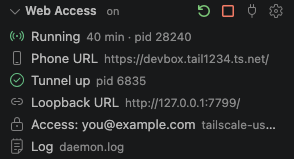

Run **DevDesk: Start Web Access**. The status bar shows **Web: on**, or **Web: tunnel down** when the tunnel command stopped. Click it for:

- **Copy URL**, **Open URL** and **Show QR Code**: the URL the tunnel printed, for your phone.
- **Copy Loopback URL**: `http://127.0.0.1:7691/`.
- **Restart Tunnel**: runs the tunnel command again. **Start Web Access** does the same while the daemon runs.
- **Restart Web Access**: stops the daemon and starts it again, with the current settings and this version's page.
- **Stop Web Access**: stops the daemon and its tunnel. **DevDesk: Stop Web Access** does the same.
- **Settings**.

The **Web Access** view, under Worktrees in the DevDesk sidebar (collapsed at first), shows the same at a glance, also while web access is off. Its title bar has **Start** (or **Restart**), **Stop**, **Choose Web Access Tunnel** and the settings gear. Hover a row with something worth copying (a URL, a process id, the tunnel's error, the allowed users, the log's path) for its copy button, also in its right-click menu. Its rows:

- **Running**: since when, and its process. **Started by version 1.6.0** means a daemon an older version started is still running: an update doesn't restart it, so the phone still gets the old page. Click the row to restart it.
- **Phone URL**: click to copy; its buttons open it or show its QR code.
- **Tunnel**: click to restart it.
- **Tunnel name**: the tunnel's name for this machine (`devdesk.web.tunnelName`, else the host name), with its URL in the tooltip, also while web access is off. Click it to change the name, with a preview of the name and URL as you type. It shows only when the tunnel command has `{host}`.
- **Loopback URL**: for `ssh -L`; click to copy.
- **Access**: who may open the page (`devdesk.web.allowedUsers` and how it is checked: Tailscale, ngrok sign-in, Cloudflare Access or the header), *the tunnel owner* with Dev Tunnels, or *no identity check* with `loopback`.
- **Log**: `daemon.log`.

The daemon lists the sessions of the window that started it, as its Claude view does (`devdesk.sessions.scope`, `devdesk.sessions.show`). Changing a `devdesk.web`, `devdesk.sessions` or `devdesk.claude` setting (the Claude accounts) restarts it with the new values. It starts new sessions in the default launch mode and Claude account, as **New Claude Session** does. Its files are in `~/.claude/devdesk/state/web-v2/` (under `devdesk.sessions.stateDir`): `web.json` (its pid, port and URL), `config.json` (the settings it runs with) and `daemon.log`.

**DevDesk Claude v1 and v2 each have their own.** Both can be installed on one host and share the sessions state directory, so each runs a daemon of its own: v2 on port `7691` with its files in `web-v2/`, v1 on `7690` in `web/`. Start Web Access in a v2 window starts v2's daemon and never stops or restarts v1's. Both can run at once, each at its own URL; stop the one you don't use.

### Who can open it

The daemon listens on `127.0.0.1` only (port `devdesk.web.port`, `7691`), so a phone never reaches it directly. It goes through the proxy, which signs you in and forwards the request with your name in a header. The proxy must replace any value of that header the browser sent: check that yours does.

`devdesk.web.auth` decides what the daemon checks:

- **`header`** (default). The request must carry the header `devdesk.web.identityHeader`, and its value must be one of `devdesk.web.allowedUsers`, exactly (case and spaces count). When either setting is empty, every request gets a page that says what to set. Nothing gets through by default.
- **`loopback`**. No identity check, for `ssh -L`. Any process on this host can then open the page and drive your Claude sessions. The daemon then answers on `127.0.0.1` and `localhost` only, runs no tunnel, and refuses to start when `devdesk.web.tunnelCommand` or `devdesk.web.publicHost` is set, so nothing reaches it unchecked through a proxy.

The daemon also refuses requests for any host but `127.0.0.1`, `localhost` and the proxy's (`devdesk.web.publicHost`, else the host of the URL the tunnel printed). Replies, keys and new sessions must come from the page itself (same origin).

> **Use web access only on a host no one else uses.** Any process on this host can reach `127.0.0.1` and set the header itself. A dev machine of your own is fine; a shared host is not.

### How the list is ordered

The list follows the Claude view's order (`devdesk.sessions.sort`, see [Order](#order)), and groups the sessions under four headings: *Needs you* (waiting for you, blocked, or done and not read yet), *Working* (also done sessions waiting on background work), *Other* (done sessions you've read, idle ones: done and not updated for `devdesk.sessions.idleMinutes`), and *Not running* (parked sessions, the newest `devdesk.sessions.finishedSessions` per worktree, as in the Claude view). Opening a session under *Not running* resumes it, as opening it in the Claude view does: Claude starts again with `claude --resume` in the tmux pane or session it had (else a new one named after its worktree), and the page opens it once it runs. A session counts as read the way the Claude view counts it: once its terminal was in front of you in VS Code. The extension shares that with the daemon in `web-v2/seen.json`. If the daemon finds no `seen.json` (it was started by hand), it counts every session as unread. Then anything done in the last 30 minutes shows under *Needs you*.

On the session screen, the keys **1**, **2**, **3** and the others replace the reply box only while a dialog or choice replaces Claude's prompt box. If text is already typed at Claude's prompt, the reply box stays and the page asks you to clear that text in the session's terminal first, because DevDesk doesn't type after what's there.

### Run it without VS Code

The daemon is a plain Node program, so you can start it on the host yourself, for example inside tmux so it outlives your SSH session:

```sh
node <extension dir>/dist/web.js --port 7691 --root <your repo> \
  --identity-header Tailscale-User-Login --allow-user you@example.com
```

`<extension dir>` is where VS Code installed DevDesk for Claude Code (`~/.vscode-server/extensions/roniburd.devdesk-claude-<version>` on a remote host). Without VS Code's settings it uses the defaults: state in `~/.claude/devdesk/state`, tmux server `devdesk`, every session, no tunnel. The flags are `--port`, `--auth header|loopback`, `--identity-header`, `--allow-user` (repeat it for more users), `--public-host`, `--tunnel-command`, `--state-dir`, `--root` and `--poll-ms`. There is no flag for the address: it listens on `127.0.0.1` only. Stop it with Ctrl-C, or with `kill <pid>`; the pid is in `~/.claude/devdesk/state/web-v2/web.json`. Started this way it lists every session and runs no tunnel unless you pass `--tunnel-command`; it reads Claude's session registry in `~/.claude/sessions` only, so sessions of other Claude accounts show without their names.

### When it doesn't start

- **Port 7691 is in use**: something else listens there, maybe a web access daemon you started by hand. Change `devdesk.web.port`.
- **Web: tunnel down**: the tunnel command exited, or printed no URL within 60 s. The status bar item's tooltip shows its last line, and for a preset a notification says what to do (sign in, add the ngrok authtoken, let your user run Tailscale Serve). Loopback still works. Fix the cause, then **Restart Tunnel**, or **Choose Tunnel** to pick another.
- Anything else: the error offers **Open Log** (`daemon.log`). A daemon that crashed leaves a stale `web.json`; the next Start replaces it.

## 18. Troubleshooting

### Sessions show NO STATUS, or never change state

The status hooks are missing, or the session started before you installed them.

1. Install the hooks. See [Set up status hooks](#2-set-up-status-hooks).
2. Restart the session.

If you changed `devdesk.sessions.stateDir`, reinstall the hooks.

### Sessions don't start, or DevDesk says tmux can't run

Install tmux. See [Install tmux](#install-tmux). If tmux isn't on your PATH, set `devdesk.sessions.tmuxPath`.

### The view spins forever, or the robot icon does nothing

**Cause.** The extension host is starved, most often on a remote machine. Usually VS Code's own file search is crawling large build outputs or symlink farms in every worktree.

**Check.**

- Look in **Output → DevDesk** for `extension host event loop was blocked` warnings.
- On the machine the extension runs on, run `ps aux | grep 'rg --files'`. It shows `rg` processes using many GB.

**Fix.** Add this to your VS Code user settings, then reload the window:

```jsonc
"search.followSymlinks": false,
"search.exclude": { "**/node_modules": true, "**/build": true, "**/dist": true },
"files.watcherExclude": { "**/node_modules/**": true, "**/build/**": true }
```

List your own build output folders there too.

**If it still happens.**

- A reload doesn't always stop the previous extension host. Run `ps -eo pid,etimes,rss,args | grep type=extensionHost` and stop old ones.
- Set the DevDesk output channel to **Debug**. It shows per-package timings and memory every 10 seconds.
- If the Worktrees view is slow, see [How DevDesk loads changes](#how-devdesk-loads-changes).

### A session shows as unread when it shouldn't, or the other way around

First, check what counts as unread: see [Read and unread](#5-read-and-unread).

**Check.**

- **Output → DevDesk** logs each `read state:` change with its reason. It also logs which Claude terminals were in front.
- Run **Worktrees: Write Claude Session Diagnostics**. It writes a JSON snapshot to the extension's log folder and opens it. For every session, the snapshot has its state, its last read change, and its signature: a summary of what it shows, next to the saved one. It also lists the window's terminal tabs.

**Notes.**

- The read state is saved across reloads and restarts.
- A session that drops out of the list for a while keeps its read state. The log says `no longer listed`.
- DevDesk keeps the read state of only the 500 most recently seen sessions.

## 19. All settings

Settings marked *machine* apply to the whole machine, so set them in your User settings (in a Remote-SSH window, its Remote settings), not a folder's: they decide what every window does to the sessions or files all windows share (parking, the usage history). A value in a workspace or folder's settings is ignored.

### Sessions

| Setting | Default |
|---|---|
| `devdesk.sessions.show` | `vscode` (`all` lists every Claude session on the machine) |
| `devdesk.sessions.scope` | `workspace`: only sessions working in this window's workspace (`all` lists every folder's) |
| `devdesk.sessions.groupByWorktree` | `false` (one flat list, each row naming its worktree; `true`: sessions nested under their worktree; the Claude view's list button toggles it) |
| `devdesk.sessions.sort` | `urgency`: what needs you first, then recently finished unread, working, stuck, the rest, not running, parked (`attention`: the order from before, see [Order](#order)) |
| `devdesk.sessions.recentlyFinishedMinutes` | `15` (with `urgency`, an unread session whose turn finished less than this long ago sorts above working ones) |
| `devdesk.sessions.unreadFirst` | `true` (with `attention`, unread sessions sort above every read one; `false`: only within their state) |
| `devdesk.sessions.dimRead` | `true` (read sessions' titles are gray in the Claude view and on the Claude Board) |
| `devdesk.sessions.unreadBadge` | `true` (a `●` on unread sessions in the Claude view and on the Claude Board) |
| `devdesk.sessions.notifyWhenWaiting` | `true` |
| `devdesk.sessions.statusBar` | `true` (the `N needs you` status bar item) |
| `devdesk.sessions.stuckMinutes` | `10` (a working session with no hook event for this long shows as stuck) |
| `devdesk.sessions.hooksQuietMinutes` | `2` (a session whose hooks have said working or waiting this long, with no new hook event, shows the state Claude itself reports when it differs; needs `devdesk.sessions.programStatus`; `0`: never) |
| `devdesk.sessions.idleMinutes` | *machine*, `30` (a finished session not updated for this long sorts after working and recently finished ones) |
| `devdesk.sessions.resortWorkingMinutes` | `5` (working sessions keep their order this long before sorting again, newest first; `0`: always sorted) |
| `devdesk.sessions.readAfterSeconds` | `1.5` (a session's terminal must be in front this long for what happened in it to count as read) |
| `devdesk.sessions.finishedSessions` | `10` (parked sessions listed per worktree, on the board and on the web access page; older ones fold into one row) |
| `devdesk.sessions.showChildren` | `false` (`true`: subagents, background shells and workflows under each session) |
| `devdesk.sessions.finishedChildren` | `10` (finished ones listed per level; older ones fold into one row) |
| `devdesk.sessions.turnChangesTurns` | `30` (recent turns **Show Changes by Turn…** lists, see [See what a turn changed](#see-what-a-turn-changed)) |
| `devdesk.sessions.turnChangesMaxMB` | `64` (MB read at most from the end of a session's transcript, and of each subagent's, to show a turn's changes) |
| `devdesk.sessions.pollSeconds` | `3` (how often, in seconds, DevDesk reads session states) |
| `devdesk.sessions.parkAfterDays` | *machine*, `2` (a DevDesk session inactive this long is parked: its tmux session and Claude end, its row stays to resume it; `0`: never park, also turns off the three below) |
| `devdesk.sessions.parkReadAfterMinutes` | *machine*, `60` (park sooner a finished session you've read that neither ended on an error nor asks a question; `0`: only `parkAfterDays`) |
| `devdesk.sessions.maxLiveSessions` | *machine*, `12` (when more DevDesk sessions run, park the idle ones, read and least recently active first; `0`: no limit) |
| `devdesk.sessions.parkBelowFreeMemoryPercent` | *machine*, `10` (while less memory is free, park one more idle session each minute; `0`: never) |

### Starting Claude

| Setting | Default |
|---|---|
| `devdesk.sessions.defaultMode` | `Default` (the mode +, the robot icon and Fork use; a dropdown of the shipped modes) |
| `devdesk.sessions.modes` | Default, Manual, Accept edits, Auto, Plan, Don't ask, Bypass (clauded) |
| `devdesk.sessions.claudeArgs` | none (for example `--model opus`; added to every mode) |
| `devdesk.sessions.claudePath` | `$HOME/.toolbox/bin/claude` when it exists, else `claude` on PATH |
| `devdesk.sessions.command` | empty: `<claudePath> <claudeArgs>; exec $SHELL -l` (set it to replace the whole command) |
| `devdesk.claude.accounts` | *machine*, none (one account, Claude's own config directory; see [Claude accounts](#claude-accounts)) |
| `devdesk.claude.defaultAccount` | empty (the first account listed; a folder's workspace settings can set its own) |
| `devdesk.claude.disableAutoUpdater` | `false` (sessions DevDesk starts run with `DISABLE_AUTOUPDATER=1`) |
| `devdesk.sessions.programStatus` | *machine*, `true` (new sessions run Claude under a small Python relay that answers its status probe, OSC 7501, so sessions without hooks show working, waiting or idle, and sending to a session trusts Claude's own report; not with `devdesk.sessions.command`) |

### Terminals

| Setting | Default |
|---|---|
| `devdesk.sessions.restoreTerminals` | `true` (a new window reopens the Claude terminals that were open, attached to their still-running tmux sessions, resuming those DevDesk parked meanwhile) |
| `devdesk.sessions.leftArrowOpensSidebar` | `true` (← on an empty Claude prompt focuses the Claude view; new sessions start without Claude's agent view) |
| `devdesk.sessions.tabTitleLength` | `24` (characters of the session's title its terminal's tab shows; `0`: the session's name) |

### Worktrees

| Setting | Default |
|---|---|
| `devdesk.worktrees.root` | the git repository containing the first workspace folder (its main worktree), else the folder itself (no worktrees then); the views are hidden only with no folder open |
| `devdesk.worktrees.showSessions` | `true` (each worktree lists its Claude sessions above its packages, as the Claude view does; `false`: packages only; the Worktrees view's comment button toggles it) |
| `devdesk.worktrees.showCleanPackages` | `false` (only packages with changes are listed under a worktree; a clean worktree shows `No changes`) |
| `devdesk.worktrees.refreshSeconds` | `20` (seconds between the end of one refresh and the start of the next; 0: refresh only on demand) |
| `devdesk.worktrees.activeReloadSeconds` | `60` (a package of an expanded worktree, or of one a Claude session is busy in, loads again at least this often; 0: only when something says it changed) |
| `devdesk.worktrees.idleReloadMinutes` | `10` (the other packages load again about this often, a few on each refresh, up to half as late again; 0: only when something says they changed) |
| `devdesk.worktrees.pauseWhenUnfocused` | `true` (no timed refresh while the VS Code window is in the background) |
| `devdesk.worktrees.prefetch` | `true` (while the view is visible, every worktree's changes load in the background, so expanding one is instant and its row shows `N changed` / `clean`) |
| `devdesk.worktrees.maxGitProcesses` | `8` (the most git processes the Worktrees view runs at once; an expanded worktree may use all of them, background loads up to half, or a quarter while the load average is above 1.5 per CPU) |
| `devdesk.worktrees.gitTimeoutSeconds` | `30` (a slower git command of the Worktrees view is stopped and its package shows an error; 0 never stops it) |
| `devdesk.worktrees.startPrompt` | `You are working in worktree {worktree} ({dir}) on: {task}` + "say which worktree you are in, then work on the task" |
| `devdesk.worktrees.cleanupIdleDays` | `3` (**Clean Up Worktrees…** lists only worktrees with no commit, checkout or rebase for this many days) |
| `devdesk.worktrees.cleanupBaseBranches` | `[]` (branches a worktree's commits must be in, any of them; empty: each package's mainline) |
| `devdesk.worktrees.cleanupDeleteBranch` | `false` (also delete a cleaned-up git worktree's branch) |
| `devdesk.worktrees.cleanupSuggestCount` | `5` (offer **Clean Up Worktrees…** when a window opens and this many are ready; 0: never) |
| `devdesk.worktrees.autoTrust` | *machine*, `true` (accept Claude's trust dialog for a worktree DevDesk makes, and its packages, when Claude trusts the workspace or repository it is made in; see [Trust for new worktrees](#trust-for-new-worktrees)) |

### Pull request checks

| Setting | Default |
|---|---|
| `devdesk.checks.enabled` | `true` (worktree rows and board cards show failing checks and open review comments of their pull requests; **Ask Claude to Fix Checks**) |
| `devdesk.checks.refreshMinutes` | `5` (a listed worktree's checks are read again at most this often while the Worktrees view is visible; 0: only when you ask) |
| `devdesk.checks.maxBackoffMinutes` | `60` (after failures in a row, the wait doubles up to this) |
| `devdesk.checks.timeoutSeconds` | `30` (a slower `gh` call is stopped) |
| `devdesk.checks.reviewComments` | `true` (count the review threads not resolved yet, and put them in the prompt) |
| `devdesk.checks.logLines` | `40` (lines of a failing check's failed log in the prompt; 0: its link only) |
| `devdesk.checks.maxLogs` | `3` (failed logs read for one prompt; the other failing checks get their link only) |
| `devdesk.checks.ghPath` | *machine*, `gh` on PATH |

### Tickets

| Setting | Default |
|---|---|
| `devdesk.tickets.enabled` | `true` (link tickets to worktrees and sessions; chips on worktree rows and board cards) |
| `devdesk.tickets.autoDetect` | `true` (find a worktree's ticket in its branch and name, a session's in its first prompt) |
| `devdesk.tickets.includeInPrompt` | `false` (add the worktree's ticket after the prompt of a session the board starts there) |
| `devdesk.tickets.fetch` | `true` (read titles and statuses where DevDesk can: `gh`, the Jira command) |
| `devdesk.tickets.refreshMinutes` | `10` (a ticket is read again at most this often, a failure too) |
| `devdesk.tickets.timeoutSeconds` | `15` (a slower read is stopped) |
| `devdesk.tickets.providers` | `[]` (the trackers on, by id; empty: all) |
| `devdesk.tickets.jira.baseUrl` | empty (no Jira) |
| `devdesk.tickets.jira.projects` | `[]` (any project key) |
| `devdesk.tickets.jira.command` | *machine*, empty (Jira is link only) |
| `devdesk.tickets.linear.workspace` | empty (Linear links only, no bare keys) |
| `devdesk.tickets.linear.teams` | `[]` (any team key) |
| `devdesk.tickets.patterns` | `[]` (trackers of your own: `{ "name", "regex", "url" }`) |

### Claude Board

| Setting | Default |
|---|---|
| `devdesk.board.openWhenEmpty` | `true` (open the Claude Board when the editor area has no tabs) |
| `devdesk.board.openWithSidebar` | `true` (open the Claude Board the first time you open the Agent Sessions sidebar in a window) |
| `devdesk.board.editorTitleButton` | `true` (a colored board button at the top right of each editor group opens the Claude Board) |
| `devdesk.board.promptPlacement` | `bottom` (the prompt box in its own square under the lanes; `top` the same square above them) |
| `devdesk.board.sidebarPrompt` | `true` (the New Session view: the board's prompt box at the top of the Agent Sessions panel, above the Claude view) |
| `devdesk.board.afterStart` | `board` (stay on the board after starting a session; `session` opens its terminal) |
| `devdesk.board.sessionsBeside` | `auto` (a session opened from the board shows its terminal beside it when the editor area is wide enough; `always`, `never`) |
| `devdesk.board.cardTitle` | `objective` (a prototype: the card's title is what the whole session sets out to do, with the latest step under it); `latest`: the title is what the latest prompt is about |
| `devdesk.board.cardLine` | `true` (one line on Working cards, what Claude is doing, and on Needs you cards, what it asks; the header's ☰ toggles it) |
| `devdesk.board.laneWidth` | `220` (px per lane when a session opens beside the board; at least 180) |
| `devdesk.board.models` | empty (the Claude CLI's model picker rows, else `Default`, `opus`, `sonnet`, `haiku`, `fable`, `opus[1m]`, `sonnet[1m]`, `fable[1m]`: the prompt box's model choices) |
| `devdesk.board.specPrompt` | empty (**Spec**: the brainstorming skill when installed, else a write-a-spec-first instruction) |
| `devdesk.board.pastedImagesDir` | empty (`~/.claude/devdesk/pasted-images`: where images pasted into the prompt box are saved; ones older than 30 days are deleted) |
| `devdesk.board.claudeConfigFile` | empty (`$CLAUDE_CONFIG_DIR/.claude.json`, else `~/.claude.json`: read to warn before starting a session in a folder Claude has not trusted; written only by `devdesk.worktrees.autoTrust`) |
| `devdesk.board.pasteSettleMs` | `500` (ms the board waits after pasting a command into a running session before it presses Enter, 1 ms more per 4 KB; raise it if a sent command stays typed instead of running) |

### Insights

| Setting | Default |
|---|---|
| `devdesk.insights.enabled` | `true` (a small model's live status, summary and asked-you answer on session cards) |
| `devdesk.insights.model` | `haiku` |
| `devdesk.insights.refreshSeconds` | `45` (a working session's status at most this often, after new activity; at least 10) |
| `devdesk.insights.maxConcurrent` | `5` (insight calls at the same time; 1–20) |
| `devdesk.insights.claudePath` | empty (the Claude new sessions run, `devdesk.sessions.claudePath`, without `devdesk.sessions.claudeArgs`) |

### Board search

| Setting | Default |
|---|---|
| `devdesk.boardSearch.model` | empty (`haiku`) |
| `devdesk.boardSearch.command` | empty (`claude -p` with `devdesk.boardSearch.model`; otherwise a program or script, with arguments) |
| `devdesk.boardSearch.timeoutSeconds` | `30` |
| `devdesk.boardSearch.history` | on (also search past sessions' transcripts) |
| `devdesk.boardSearch.historyScope` | `workspace` (or `all`: every session on this machine) |
| `devdesk.boardSearch.historyDays` | `90` (transcripts not changed for this many days are not searched; 1-3650) |
| `devdesk.boardSearch.historyMaxSessions` | *machine*, `5000` (at most this many past sessions, the newest, are searched; 100-100000) |
| `devdesk.boardSearch.historySaveMinutes` | `5` (how often the index file is saved while transcripts grow; other windows see new text once it is; 0-60, 0: every check) |
| `devdesk.boardSearch.historyDir` | empty (`projects` in every Claude account's config directory) |

### Usage history

| Setting | Default |
|---|---|
| `devdesk.usage.defaultScope` | `project` (what the 📊 popup and the Claude Usage page show first: `project`, this window's project, or `all`, all projects) |
| `devdesk.usage.historyDays` | *machine*, `365` (days of token usage history kept, at least 1) |
| `devdesk.usage.historyMaxMB` | *machine*, `10` (the most disk the token usage history takes; the oldest days go first) |
| `devdesk.usage.planLimits` | `true` (show Claude's 5-hour and weekly plan limits in the 📊 popup and on the Claude Usage page, or offer DevDesk's status line that records them; see [Plan limits](#plan-limits)) |

### The devdesk command

| Setting | Default |
|---|---|
| `devdesk.cli.enabled` | *machine*, `true` (the window takes requests from the `devdesk` command Claude runs to open files and diffs or set a card note, and keeps the command in `~/.claude/devdesk/` up to date) |
| `devdesk.workers.maxConcurrent` | `4` (the most worker sessions one coordinator runs at once; see [Coordinator and worker sessions](#coordinator-and-worker-sessions)) |
| `devdesk.workers.nudge` | `true` (type "You have N worker messages" into a coordinator that waits at an empty prompt with unread worker messages, once per batch) |
| `devdesk.workers.escalationMinutes` | `3` (how long a worker may sit stopped without reporting before its coordinator is told) |

### tmux

| Setting | Default |
|---|---|
| `devdesk.sessions.tmuxServer` | `devdesk` (`default` is tmux's own server) |
| `devdesk.sessions.tmuxPath` | `tmux` on PATH |
| `devdesk.sessions.tmuxConfigFile` | DevDesk's `<stateDir>/tmux.conf`: your tmux config without its hooks (tmux's own on the `default` server); read when DevDesk's tmux server starts |
| `devdesk.sessions.tmuxOptions` | `{}` (for example `{ "mouse": true, "history-limit": 50000 }`, set on each session) |
| `devdesk.sessions.smoothScroll` | `false` (experimental: the wheel scrolls one line at a time) |
| `devdesk.sessions.smoothScrollLines` | `3` (lines per wheel event with smooth scrolling on, 1 to 10) |
| `devdesk.sessions.smoothScrollAcceleration` | `true` (with smooth scrolling on, fast scrolling goes further) |
| `devdesk.sessions.tmuxInstallCommand` | `sudo yum install -y tmux` (`brew install tmux` on macOS) |

### Web access

| Setting | Default |
|---|---|
| `devdesk.web.tunnel` | *machine*, `auto`: `devdesk.web.tunnelCommand` when set, else Start asks. `tailscale`, `devtunnel`, `cloudflare`, `ngrok`: that preset ([Anywhere else](#set-it-up-anywhere-else)); `custom`: the tunnel command; `none`: no tunnel |
| `devdesk.web.port` | `7691` (v1 has `7690`; the daemon listens on `127.0.0.1` only) |
| `devdesk.web.auth` | *machine*, `header` (`loopback`: no identity check, so any process on this host can drive Claude; no tunnel or public host with it) |
| `devdesk.web.identityHeader` | *machine*, empty: none, so every request is denied. Not used by the presets |
| `devdesk.web.allowedUsers` | *machine*, `[]`: no one, so every request is denied. Your Tailscale login, or your email for `cloudflare` and `ngrok` (Choose Web Access Tunnel fills it in) |
| `devdesk.web.publicHost` | *machine*, empty (the host of the URL the tunnel command prints) |
| `devdesk.web.tunnelName` | *machine*, empty: this machine's short host name. What fills `{host}` in the tunnel command (the tunnel's name), so each machine gets a tunnel and URL of its own; at most 24 letters, digits and dashes. **Set Web Access Tunnel Name** previews the name and URL |
| `devdesk.web.tunnelCommand` | *machine*, empty: no tunnel |
| `devdesk.web.pollMs` | `2000` (how often the open page's list refreshes; 500 to 60000) |
| `devdesk.web.cloudflare.team` | *machine*, empty: for the `cloudflare` tunnel, your team name (`<team>.cloudflareaccess.com`); empty denies every request |
| `devdesk.web.cloudflare.audience` | *machine*, empty: for the `cloudflare` tunnel, the Access application's AUD tag; empty denies every request |
| `devdesk.web.ngrok.oauthProvider` | *machine*, `google` (`github`, `microsoft`, `gitlab`): what visitors sign in with for the `ngrok` tunnel |
| `devdesk.web.sessionView` | `transcript` (`terminal-experimental`: [the live terminal](#the-terminal-experimental)): how a session opens in a browser that didn't choose in the page's Settings |

### Advanced

| Setting | Default |
|---|---|
| `devdesk.sessions.stateDir` | `~/.claude/devdesk/state` |
| `devdesk.sessions.claudeSessionsDir` | empty (`sessions` in every Claude account's config directory, `~/.claude/sessions` with none) |
| `devdesk.sessions.claudeJobsDir` | empty (`jobs` in the session's Claude account, `~/.claude/jobs` with none) |
| `devdesk.diagnostics.debugLog` | `false` (debug lines in the DevDesk output at info level) |
| `devdesk.diagnostics.slowOperationSeconds` | `60` (0 disables) |
| `devdesk.diagnostics.latencyOutlierFactor` | `3` (logs a command, sessions refresh, board render or tmux call that took 3× its usual time, with what DevDesk was doing; 0 disables) |
| `devdesk.diagnostics.latencyOutlierMinMs` | `50` (only slow moments at least this many ms over usual) |
| `devdesk.diagnostics.dir` | `~/.cache/devdesk/diagnostics` (fatal-error reports of the extension host) |
| `devdesk.diagnostics.heapSnapshotNearLimit` | `true` (one heap snapshot in the extension host's working directory, usually `~`; off after a reload) |
| `devdesk.diagnostics.keepDays` | *machine*, `3` (heap snapshots and fatal-error reports older than this are deleted; 0 keeps them) |
| `devdesk.diagnostics.heapWarnMB` | `1500` (0 disables) |
| `devdesk.diagnostics.heapGrowthWarnMB` | `300` per 10 s (0 disables) |
