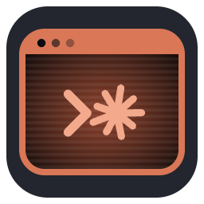
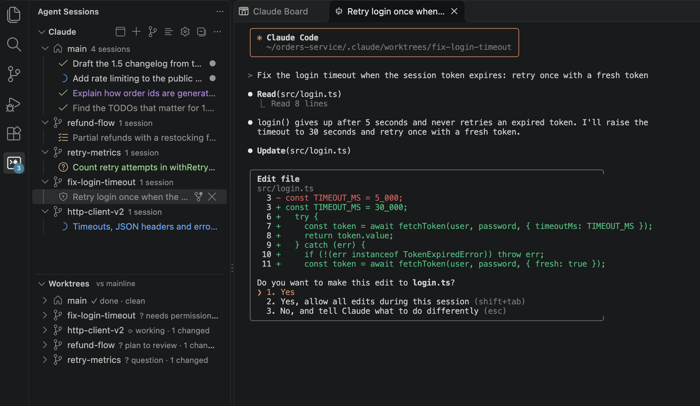
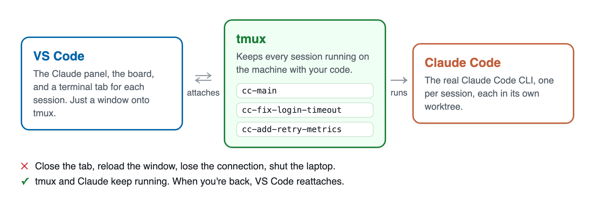
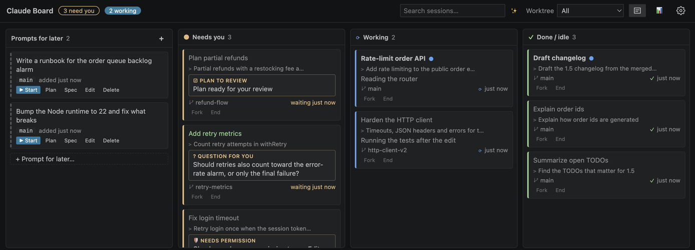
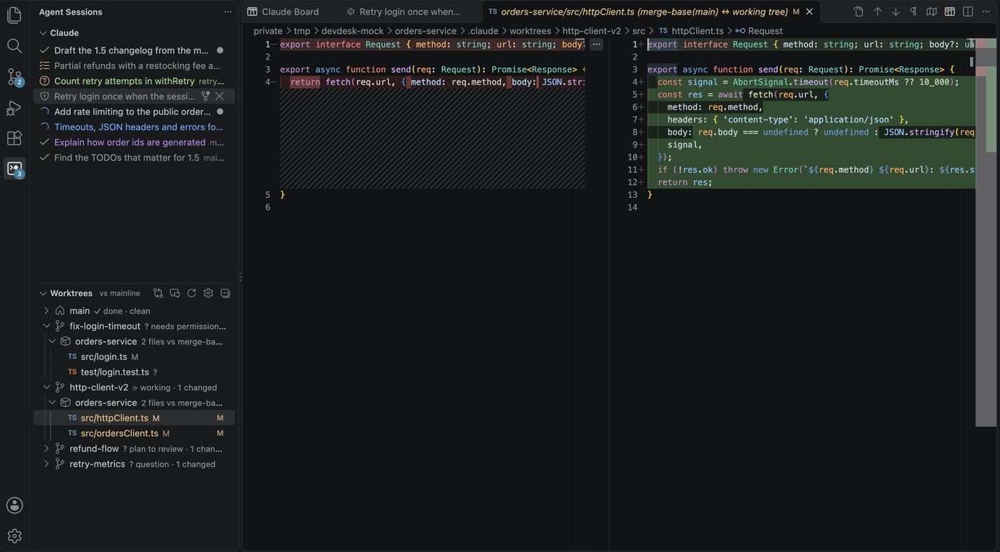
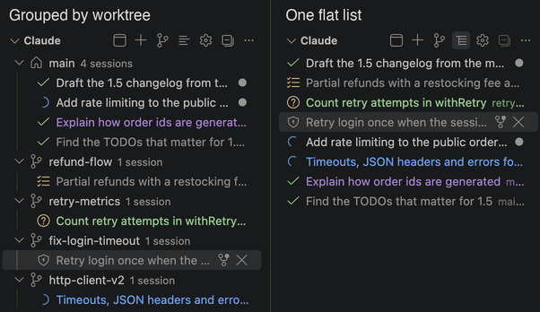
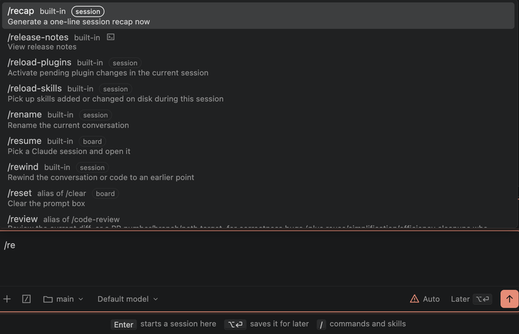
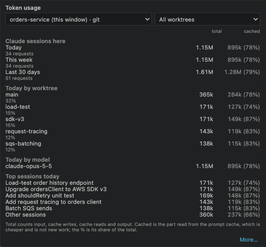
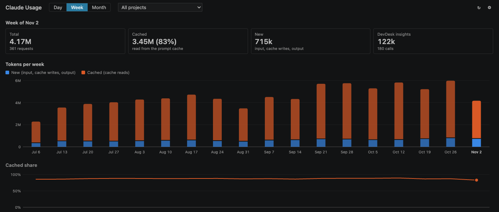

<p align="center"></p>

<h1 align="center">DevDesk Claude</h1>

<p align="center">The real Claude Code CLI in VS Code that survives restarts.<br>
Adds richer views, token statistics and worktree workflows,<br>
with the full power of VS Code: git, diffs and more.</p>

<p align="center"><a href="#install"><b>Install</b></a> · <a href="MANUAL.md">Manual</a> · <a href="https://github.com/roniburd/devdesk-agent/releases">Releases</a></p>

<p align="center"></p>

## Install

### Prerequisites

On the machine where your code is (your Mac or Linux machine, or the remote one):

- **VS Code** 1.95 or newer.
- **[Claude Code](https://docs.anthropic.com/en/docs/claude-code/setup)**, the `claude` CLI, signed in. If it isn't on
  your `PATH`, set `devdesk.sessions.claudePath`.
- **tmux**. If it's missing, DevDesk offers to install it.
- **python3**, for the hook that reports each session's state.

Windows isn't supported directly (tmux doesn't run there): use WSL or a Remote-SSH machine.

### Download and install

This is v2, a pre-release line. Download `devdesk-claude.vsix` from the newest **v2.x** release on the
[Releases](https://github.com/roniburd/devdesk-agent/releases) page (the one marked *Latest* is v1), then:

```bash
code --install-extension devdesk-claude.vsix
```

Run it where your code is:

- **On your machine:** in any terminal.
- **On a remote machine over SSH:** in the terminal of a [Remote-SSH](https://code.visualstudio.com/docs/remote/ssh)
  window to it. There `code` installs on the remote. Then run **Developer: Reload Window**.

Or, without a terminal: in the Extensions view choose **… → Install from VSIX…** (in a Remote-SSH window, it installs on the remote).

**Updating:** install the newer VSIX the same way. Your sessions keep running through it.

## Why?

Claude Code is at its best when you run several sessions at once, each on its own task. In a VS Code terminal that
gets hard: a reload or a dropped SSH connection kills them, you click through tabs to find the one waiting on you, and
the changes pile up in one checkout. DevDesk Claude keeps the real CLI and adds what running many of them needs.

<p align="center"></p>

- **The real Claude Code.** Every session is the `claude` CLI in an editor tab, with all its keys and slash commands.
- **Survives restarts.** VS Code is only a window onto tmux. Idle sessions are parked to free memory, and resume when
  you open them.
- **Private and free.** No service of its own: it reads Claude Code's local files. MIT licensed.

## What it adds to Claude Code in a terminal

| You want to | Plain Claude Code in a terminal | With DevDesk Claude |
|---|---|---|
| Keep Claude working when VS Code closes | The session ends with the terminal | **Every session runs in tmux.** Close, reload, disconnect: it carries on, and your terminals come back. |
| Know which session needs you | Check each tab | **A side panel, most urgent first:** *needs permission*, *question*, *plan to review*. **N need you** in the status bar jumps to the next. |
| Tell sessions apart | Every tab looks the same | **Color-code sessions:** right-click ▸ **Color**. The color shows in the side panel and on the board. |
| Run tasks side by side | Make worktrees by hand | **New Worktree Session** makes a worktree named after your task and starts Claude in it. |
| See what a session changed | `git diff` in each worktree | **Live diffs per worktree**, against main or only the uncommitted part, while Claude works. |
| Review what Claude did | Type your feedback into the prompt | **Leave notes on the lines of a diff**, then **Send Notes to Claude**: they go to the worktree's session as one prompt. |
| See everything at once | Not available | **The Claude Board:** every session as a card in lanes, with what it's doing or asking you. |
| Start a session in the background | Open a terminal, `cd`, run `claude` | **A prompt box** with mode, model, `/` commands, `@` files and pasted images. |
| Know where your tokens go | `/cost`, one session at a time | **Tokens by day, week and month**, per project and worktree, with the cache share. |

<table>
<tr>
<td colspan="2"><br><b>The Claude Board.</b> Cards move between <i>Needs you</i>, <i>Working</i> and <i>Done</i> on their own. A small model titles each card and writes its live status. Save prompts for later and start them with <b>▶ Start</b>, <b>Plan</b> or <b>Spec</b>.</td>
</tr>
<tr>
<td width="50%"><br><b>Worktrees and their diffs.</b> Click a changed file for its diff, and leave notes on its lines for Claude. <b>✕</b> deletes a worktree and its sessions.</td>
<td width="50%"><br><b>By worktree or one list.</b> Background shell commands and subagents show under their session. Color sessions to tell them apart.</td>
</tr>
<tr>
<td><br><b>A prompt box like Claude Code's.</b> Start in main, a worktree or a new one. Shift+Tab for the mode, <b>⌥⏎</b> to save for later.</td>
<td><br><b>Token usage.</b> 📊 on the board for today and this week, and your Pro or Max plan's 5-hour and weekly limits; <b>More…</b> for every project over time.</td>
</tr>
<tr>
<td colspan="2"><br><b>Claude Usage.</b> Tokens by day, week or month, how much came from the prompt cache, and how each period splits across your projects or a project's worktrees. The history stays after Claude Code deletes old transcripts.</td>
</tr>
</table>

## Get started

1. Open the **Agent Sessions** side panel.
   - Click its icon in the activity bar,
   - or run **View: Show Agent Sessions** from the Command Palette (**⇧⌘P** on macOS, **Ctrl+Shift+P** on Linux).
2. Click **Install Claude status hooks…**.
3. Open the board.
   - Press **⌃⌘B** on macOS or **Ctrl+Alt+Shift+B** on Linux, from anywhere. The cursor lands in the prompt box.
   - Or click the colored board button at the top right of any editor,
   - or run **DevDesk: Open Claude Board**.
4. Type your first task in the prompt box.
   - Pick where it runs with the folder button: **main**, a worktree, or **New worktree…**
   - Press **Enter**. The session starts in the background, and its card shows up in *Working*. Click it to open the
     session.
5. Add more tasks the same way.
   - Give each its own worktree, so they don't step on each other.
   - Cards move to *Needs you* when Claude asks something.
   - **⌥⏎** saves a task for later instead of starting it.

Prefer the side panel? **+** starts a session in main, and **New Worktree Session** asks for a task and starts it in a
new worktree.

## Settings you may want

| Setting | What it does |
|---|---|
| `devdesk.sessions.defaultMode` | The mode new sessions start in (Default, Plan, Accept edits, Auto, Bypass…). |
| `devdesk.sessions.claudeArgs` | Extra Claude arguments for every session, for example `--model opus`. |
| `devdesk.sessions.scope` | `workspace` (default) lists this window's sessions; `all` also lists other folders'. |
| `devdesk.sessions.notifyWhenWaiting` | Turn the "needs input" notifications on or off. |
| `devdesk.sessions.parkAfterDays` | Days of inactivity before a session is parked. `0` never parks. |
| `devdesk.sessions.maxLiveSessions` | How many sessions may run before idle ones are parked (12). `0`: no limit. |
| `devdesk.insights.enabled` | The Haiku status lines and summaries. They run through your own Claude Code and count in your usage. |

The ⚙ in each section and on the board opens them all.

## More

- [Manual](MANUAL.md): every state, setting and behavior, and how to fix a slow or stuck view.
- [The `devdesk` command](MANUAL.md#16-the-devdesk-command): lets Claude open files and diffs for you, and put a note on its card.
- [Developing](DEVELOPING.md): building from source, tests, and how to contribute.
- Found a bug or want a feature? [Open an issue](https://github.com/roniburd/devdesk-agent/issues).

**Privacy:** DevDesk talks to no service of its own. It reads Claude Code's local files, writes its state under
`~/.claude/devdesk`, and the insights call Claude through your own `claude` CLI.

MIT License. See [LICENSE](LICENSE).
